## 12 Conducting the Test

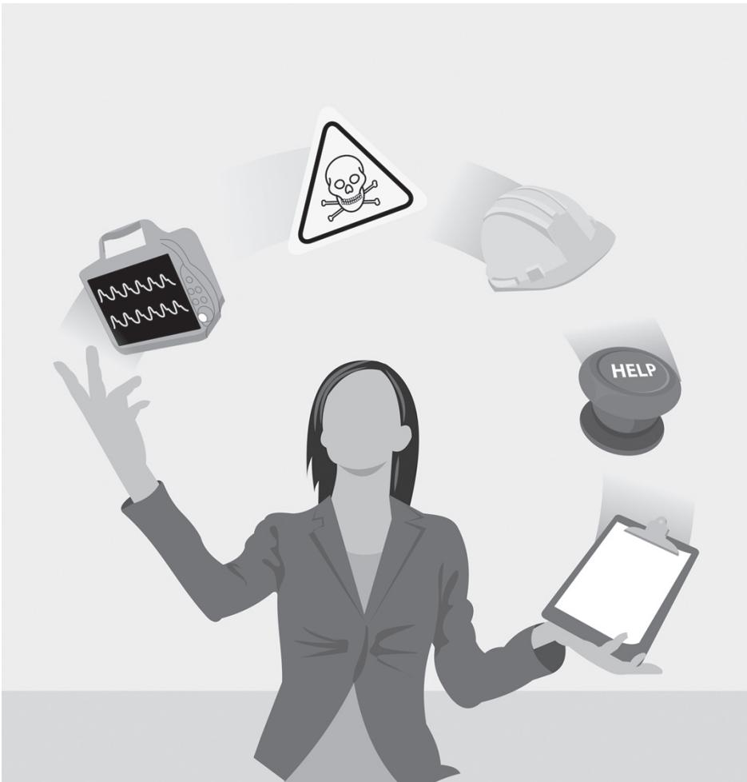

## What Is the Value of Pilot Testing?

Pilot testing prior to formal testing can spare you a ton of aggravation and help you identify multiple ways to make test sessions proceed more smoothly and effectively. For example, pilot test results might lead you to change the order of directed tasks to ensure a realistic workflow, adjust how you collect data to ensure completeness and accuracy, and resolve device prototype shortcomings (e.g., fix things that are not working properly). Conducting one or two pilot test sessions just days or even hours ahead of formal testing should suffice.

Pilot testing provides the opportunity to fine-tune a usability test before you start collecting data that counts. While conducting a pilot test is helpful for all usability test types, it is a particularly important step prior to summative usability testing. Summative usability testing is not the time and place to mess up a usability test and generate false-positive or false-negative results.

We usually conduct a pilot test a couple of days before starting a summative usability test, which provides ample time to make the following kinds of modifications:

•	 Adjust interview questions to be relevant and incisive

•	 Adjust the test environment to be more realistic

•	 Reposition video cameras to do a better job of capturing critical details

•	 Modify or subtract directed tasks so that you can complete the test in the available time

•	 Adjust the task order to achieve a more natural workflow

In addition to identifying opportunities to improve the test methodology, a pilot test also serves these purposes:

•	 Gives vested parties the opportunity to observe the test and voice any methodological concerns prior to actual testing

•	 Confirms that safety precautions and preventive measures are effective

•	 Enables test administrators to rehearse their roles, including providing any training that might be required, asking questions in an unbiased manner, and observing and documenting use errors

•	 Enables the data logger to refine data collection forms (e.g., use error checklist) and confirm that testing will not outpace his or her ability to record data in real time

•	 Confirms that the test item is in proper working order, which is particularly important if the item was shipped to the test site and might have been damaged in transit or if the item is an unstable prototype (i.e., has “buggy” software)

When conducting a formative usability test, you might opt to conduct the pilot test just hours before the formal sessions begin. That way, you only need to set up for testing once. Also, this approach allows observers who might have traveled a long distance to the test facility to view the pilot test and the formal test sessions during the same visit. If you take this approach, schedule at least a 2- to 4-hour break between the pilot test and the formal test sessions, affording the time to make necessary methodological adjustments. Note that a short break between pilot and formal test sessions precludes making major adjustments or recovering from major problems, such as malfunctioning equipment. Be prepared to cancel the first few test sessions if serious problems arise that must be fixed.

If the vested parties cannot physically attend the pilot test, they might choose to observe the session in a Web-based video conference via Skype™ or another available service.

## When to Conduct a Pilot Test Far in Advance of Formal Testing

There might be situations in which conducting a pilot test a few weeks (rather than a few days or hours) before testing is most sensible. One such situation would be if you are unable to interact and become familiar with the test item (i.e., device) when planning the test. This might occur if the device is too large to move or only available in limited quantities (or locations). You might also want to conduct a pilot test a few weeks in advance if you expect that such testing might reveal residual design flaws that need to be remedied before starting formal testing. Regardless of when you conduct the pilot test session, it is important to seek and receive IRB approval before proceeding. As one IRB training program states, “The determination [for exemption] must be made prior to initiation of research or of the activity. It cannot be made retroactively.”1

## Who Should Observe the Test Sessions?

Anybody interested in, or responsible for, the usability and general appeal of the given medical device will likely benefit from observing test sessions. At a minimum, it is helpful to have one or two observers in attendance to provide technical support during the test.

The usability test guest list could grow long if you invite everyone invested in the interactive qualities of a given medical device. But, it is usually impractical to invite dozens of observers whose concurrent attendance could create undue stress for the test administrators and participants alike, plus overfill the observation room. Moreover, there are some tests for which you want to maintain a low profile (i.e., fly below the radar) and some for which you want to show off, so the size of the guest list may vary accordingly.

Testing in a classic focus group facility that has two rooms separated by a oneway mirror opens the door to more observers (Figure 12.1). We have conducted tests observed by as many as 15 people at a time and perhaps 25–30 total, with most observers coming to watch some but not all test sessions. However, two or three observers is the norm, partly due to the cost of traveling to a distant testing location or because stakeholders who would otherwise attend are too busy.

Tests conducted and observed from within the same room (Figure 12.2) constrain the number of observers, ruling out large crowds due to space limitations and the need to limit inappropriate distractions. Some usability test professionals believe that observers should never be in the same room as the test participant. In fact, some do not even like the test administrators to be in the same room because they could bias the participant we see benefits to administering from within the same room as the test participant.

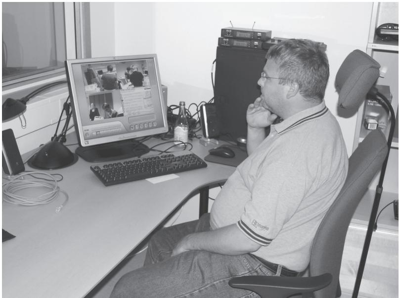  
Figure 12.1 Design team member observes a usability test session through a one-way mirror and via real-time video.

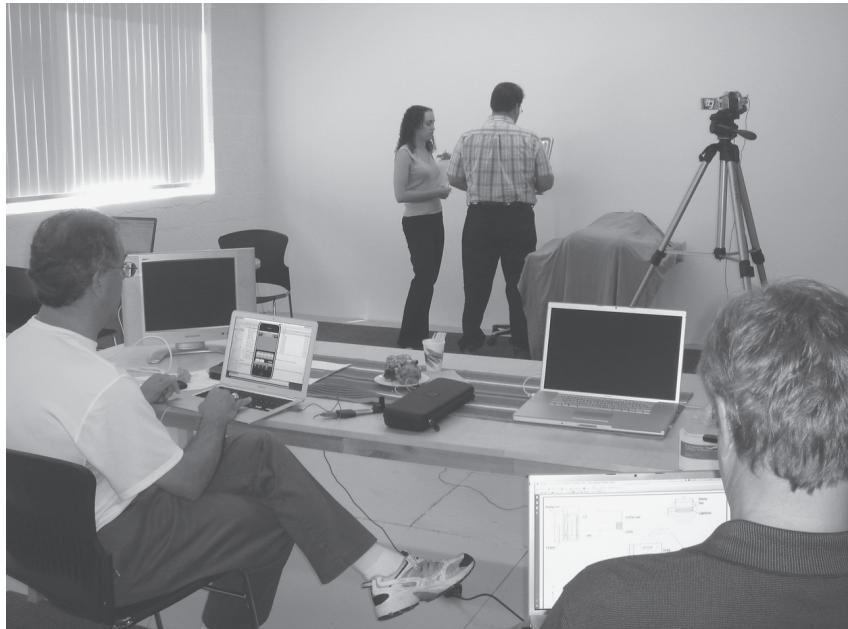  
Figure 12.2 Design team members observe a usability test from within the testing room.

We usually take a more relaxed approach regarding the years of observation, recognizing that tests conducted in hospital conference rooms and hotel meeting rooms, for example, do not provide an alternative viewing option unless you stream video to another room or facility. As long as observers promise to be neutral and quiet observers, we think it is acceptable for two or three observers to sit some distance behind the test participant, out of the line of sight. Tests involving children and particularly self-conscious individuals might be the exception.

The most avid observers tend to be:

•	 Product or project managers who are driven to ensure the customer acceptance and appeal of a medical device and take an immersive approach to achieving the goal

•	 Software development managers who have embraced the value of human factors engineering and want to see firsthand how well users are able to perform software-based tasks

•	 Marketing professionals who want a “heads-up” on how well the evolving design is meeting the established customer requirements

•	 Industrial designers, mechanical engineers, software engineers, and electrical engineers who seek evidence that suspected usability problems truly warrant design modifications

•	 Technical writers and trainers who want to see which tasks pose greater challenges to users and warrant job aids, such as a quick reference card, animated video, or particular user manual content

•	 Regulatory affairs specialists who might be leading the response of their company to the enforcement action taken by a regulator and seek assurance that usability problems are identified and resolved

•	 User interface designers (if not the same individuals administering the usability test) who might need to make design modifications based on the test results

Do you see how the guest list could grow? You might have to practice triage to decide who gets to observe the test sessions. Taking a “round-robin” approach in which interested parties observe a subset of the test sessions can be the most politically palatable and functionally effective way to go.

In any case, individuals with a vested interest in usability test results should observe test sessions. We feel more confident when an observer has in-depth technical or medical knowledge that we can draw on to answer detailed questions that might arise when the device needs special “care and feeding” or even malfunctions and requires repair. Accordingly, a clinical specialist who also serves in a marketing role makes a great observer.

Here are a few more points about observers:

•	 You will want to keep them well fed to avoid crankiness. We are partial (we are half serious) to deli sandwiches or pizza, pretzels, and either chocolate chip cookies or peanut M&Ms (plain will do) because we can also snack during breaks between test sessions. Well-fed (and hydrated) observers are generally more congenial and attentive.

•	 Observers should refrain from emotional outbursts (e.g., laughing or asserting “I can’t believe he did that!”) during the tests because test participants might still hear voices through the theoretically soundproof walls.

•	 Observers should refrain from drawing conclusions about the test results based on a small proportion of the total number of test sessions. Most people who have observed usability test sessions will agree that no two test participants are alike; rarely do they provide identical feedback or interact with the product in precisely the same manner.

•	 People who will observe only a portion of the total number of test sessions should observe at least three sessions to avoid developing distorted impressions of the interactive quality of a medical device.

Observers with little, if any, human factors engineering or usability testing experience should probably refrain from dictating test protocol changes. Unfortunately, they might not. Therefore, you might want to take a proactive approach to avoiding conflict. Check with the project manager (or whoever you collaborated with to plan the test) after each of the first few sessions to ensure that he or she is satisfied with the way in which you are conducting the test and interacting with participants. Seeking this feedback early will enable you to make any necessary methodological adjustments to satisfy concerns while maintaining the integrity of the test.

If it is okay with the test participant, who might have time limitations or be worn out, otherwise one or two observers may conduct a follow-up chat with the participant. However, the observers should maintain objectivity and never try to talk a participant out of a previously expressed opinion or, worse, tell the participant that he or she did something wrong. All follow-up interactions should match the same pleasant, nonjudgmental, and neutral communication style exhibited during the test session.

## Ensuring Good Etiquette

Before starting testing, it is important to orient your observers to the test environment and emphasize the importance of being unobtrusive, especially if they are sitting in the test room. This can feel awkward at times because external consultants do not want to “discipline” their clients, so be diplomatic. Underscore the importance of creating a neutral testing environment in which participants can perform directed tasks with minimal interference. If you need to remind a group of observers about proper test observation etiquette, consider speaking with the project leader or manager, who can then spread the message to his or her colleagues.

## What Kinds of Usability Problems Arise during a Usability Test?

Practically every usability test reveals design problems or at least issues. That is the bad news if you are reluctantly fulfilling a de facto requirement to conduct a test. Conversely, that is the good news if you are pursuing interactive excellence because a usability problem signals an opportunity for design improvement. Conducting usability tests early in device development helps ensure that usability problems that arise in later tests are minor ones that may be easily mitigated.

Usability tests of medical devices (Figures 12.3–12.7) can reveal a wide variety of usability problems that might lead to personal injuries, reduced task effectiveness, and dissatisfaction. Here is a sample of 50 problems—adapted from real test findings—to give you a sense for their variety. For consistency and conciseness, each problem is stated as a user action, inaction, or perception, followed by a description of the root cause.

1. Terminology. Could not find the trend graph, even after browsing through multiple screens, due to poor menu option wording.

2. Graphic interpretation. Selected the wrong operational mode due to icon misinterpretation.

3. Legibility. Misread a parameter value due to small numbers, poor text-tobackground contrast, and screen glare.

4. Confirmation. Accidentally deleted information due to lack of a confirmation dialogue.

5. Visual distinction. Turned a function on instead of off due to a toggle ambiguity\* and insufficient graphical distinction between virtual button positions (i.e., normal vs. indented) on a touch screen display.

6. Compatibility. Connected a tube to the wrong port due to the similar appearance (e.g., same color) and physical compatibility of the components.

7. Prompt. Fully discharged the battery due to the lack of a “low-battery” prompt complete with instructions to plug the device into AC (alternating current) power as soon as possible.

8. Guard. Squeezed a finger in a hinged compartment door due to the lack of a guard.

9. Handles. Strained wrist picking up a heavy device because the handle was neither hinged nor aligned with the center of gravity of the device.

10. Data entry. Entered an extra zero into a number field due to an insufficient “debounce” algorithm† associated with the keypad.

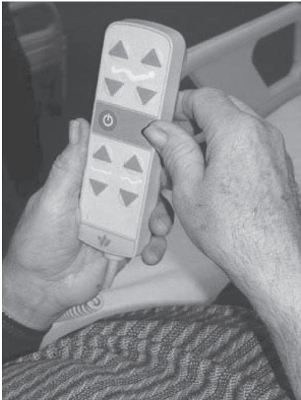  
Figure 12.3 A test participant tries to adjust the position of his hospital bed.

11. Guard. Ejected a sharp-ended part toward the face due to accidental and premature release button actuation.

12. Instruction. Failed to remove air from the fluid line (i.e., prime the line) prior to connecting it to a simulated patient due to the lack of instruction.

13. Material. Tore open a fluid bag due to material weakness while trying to mix the bag’s contents.

14. Label. Turned off instead of muted an alarm due to confusing labeling.

15. Warning. Ignored the warning to clean a sensor prior to device use, most likely due to warning saturation.

16. Visual cue. Broke a plastic cassette by forcing it into a pumping chamber backward because the front and back sides of the cassette looked nearly identical.

17. Stability. Positioned a surgical staple incorrectly due to difficulty stabilizing a minimally invasive instrument in the correct position.

18. Prompt. Lost all patient information entered into an online form because the application did not explicitly direct the user to save it before navigating to another screen.

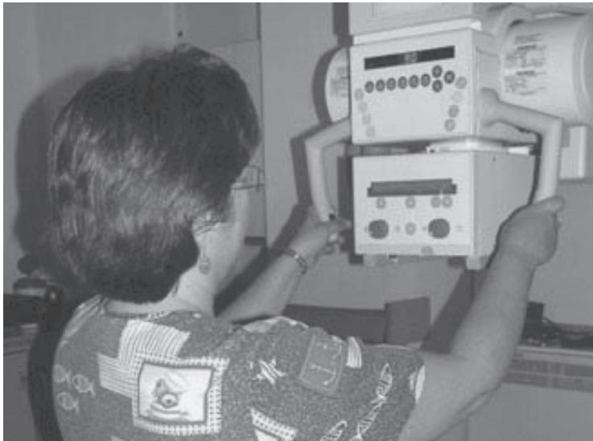

Figure 12.4 A test participant moves a medical device using its handles.

19. Instruction. Obtained an incorrect patient weight because the bed scale did not clearly direct the caregiver to remove ancillary items from the bed surface.

20. Storage. Discarded a reusable device component because it appeared to be disposable, and there was no obvious place to store it following device use.

21. Instruction. Failed to disinfect the injection site because the instructions for use did not include the step or delineate proper aseptic technique.

22. Prompt. Failed to delete previous patient data before starting to monitor a new patient, resulting in inaccurate trend data and inappropriate alarm limits.

23. Visual cue. Filled reservoir with an excessively concentrated drug because the vials of different concentrations of the same drug looked similar.

24. Pace. Failed to clamp a line with split-second precision, causing red blood cells to contaminate a bag of plasma.

25. Visibility. Left a frangible (i.e., breakable) pin intact, preventing fluids stored in separate chambers from properly mixing because the light-colored pin was difficult to see inside the fluid compartment of the plastic bag.

26. Visibility. Injected an expired medication because the expiry date was printed in small, inconspicuous characters.

27. Mechanics. Banged the rolling workstation into a door jamb because the casters were not properly aligned and caused the workstation to veer sideways.

28. Feedback. Did not press two components together with enough force to ensure a secure connection because they did not audibly “click” into place but rather were secured by friction.

29. Perception. Did not discover a necessary function due to intimidation by the numerous controls and displays of the device and reluctance to “explore.”

  
Figure 12.5 A test participant inspects a drug reservoir to ensure that it is filled properly.

30. Negative transfer.\* Turned the knob the wrong way to increase gas flow, assuming the knob worked just like the knob on another familiar device.

31. Instruction. Could not find instructions on how to perform a task because the instructions for use lacked an index.

32. Visibility. Failed to secure a syringe in its holder because the latch was inconspicuous and blended into the color-matched casing of the device.

33. Illustration. Did not insert an inhaler into the mouth while inhaling the aerosol medication because the quick reference card showed the tube in front of the user’s mouth.

34. Sound. Said the fan of the device made an unacceptably loud whirring noise that would disturb sleep.

35. Color. Repeatedly looked at the wrong waveform on the display because it was colored red (like other blood pressure waveforms) instead of some other color.

36. Affordance.† Initially could not determine how to open the pump compartment door because there was no obvious gripping point or latch.

37. Visibility. Could not locate the quick reference guide because it was inside an inconspicuous, narrow slot below the display.

38. Size. Disconnected the sensor wand because its cord was too short to reach from the normal position of the associated workstation to the patient’s upper torso, neck, and head.

39. Grip. Bent the needle during withdrawal because the handle of the injector induced rotation during withdrawal.

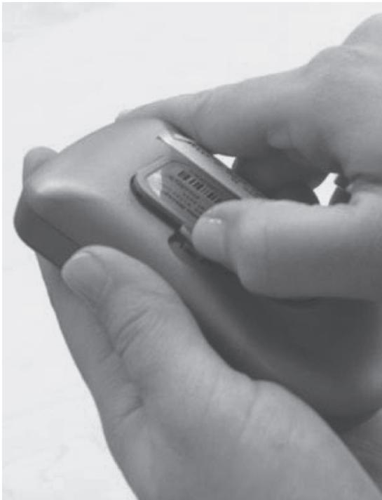  
Figure 12.6 A test participant struggles to open the battery compartment of a medical device using her fingernail.

40. Dynamics. Contaminated (and therefore wasted) the sterile, disposable instrument because it fell out of the packaging and onto the floor when the paper cover abruptly departed the underlying plastic tray.

41. Legibility. Could not read the display with the operating lights dimmed because the display did not have a backlight.

42. Label. Interpreted the time since the last measurement to be the time remaining before the next measurement due to the lack of a clarifying label.

43. Format/label. Entered the wrong procedure date because the on-screen field used the European format (DD-MM-YYYY) rather than the American format (MM-DD-YYYY) and did not provide a clarifying label.

44. Sound. Did not detect the high-frequency alarm tone due to high-frequency hearing loss (a common condition among older men).

45. Sound. Did not detect the medium-volume alarm because it was masked by the high ambient noise level.

46. Parallax.\* Selected the wrong menu option on the touch screen display due to parallax.

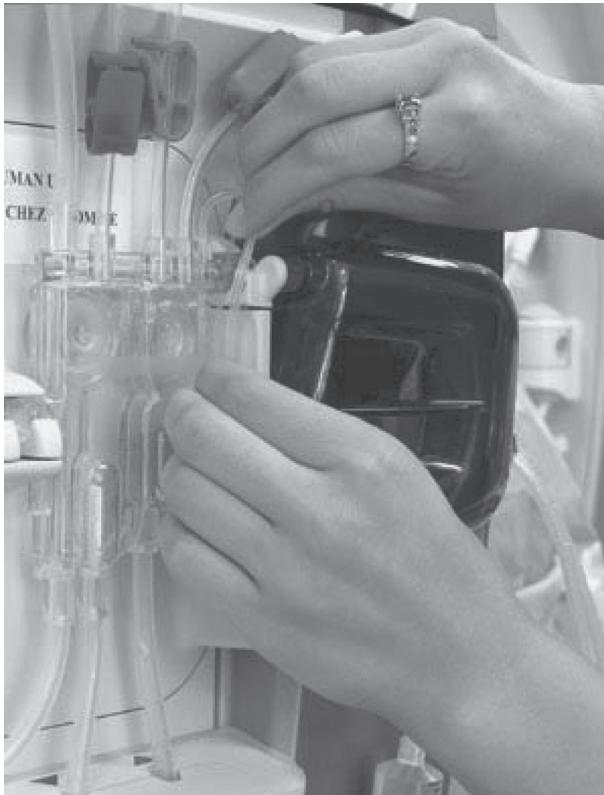  
Figure 12.7 Fitting tube into an air detector requires manual dexterity.

47. Perception. Disliked the design because its graphical user interface appeared garish and old fashioned due to the use of too many colors and unrefined icons.

48. Obstruction. Could not see the entire display when holding the device as intended.

49. Organization. Struggled to trace the lines and tubes to their source connections due to the lack of brackets to organize the “spaghetti.”

50. Control. Sensed insufficient control over catheter position due to excess catheter flex.

## What Can Go Wrong Before, During, and After a Test?

Recognizing that most usability tests go smoothly, there are dozens of things that can go wrong. Common upsets include travel delays, test participants who do not show up, test equipment breaking, failing to record the test session, and test observers misbehaving. Good planning (i.e., establishing contingencies) helps to avoid many, but not all,

of the potential upsets. No matter what hap-

pens, try to maintain a positive attitude in the face of difficulties and communicate openly with stakeholders.

Usability tests usually proceed smoothly, particularly when you are well prepared. However, no test plan (or test administrator, for that matter) is perfect. Your best efforts to run a smooth test can be overtaken by unpredictable and uncontrollable events. Recapping the events discussed elsewhere in this book and adding some new ones, we list the following bumps in the road that you might encounter before, during, and after a usability test:

•	 Your IRB has not yet responded to your request for approval to conduct the study despite their promises to do so 1 week before the start date of the test.

•	 A test participant cancels his or her session at the last minute. Weather, traffic, illness, and anxiety over being videotaped are the frequently cited reasons for canceling. Sometimes, we are pretty sure the real reasons are oversleeping and more appealing social plans.

•	 A test participant mistakenly shows up a day (or more) early and still wants to participate in a test session as well as be compensated. Meanwhile, you already have a full test schedule and cannot accommodate the request.

•	 Your recruiting screener was incomplete, resulting in one or more test participants being disqualified due to an unanticipated characteristic detected during testing, such as a working memory deficit or an active affiliation with a competing manufacturer.

•	 You offer refreshments that are inappropriate for the test participant (e.g., sugary snacks to people with diabetes) or could trigger food allergies (e.g., foods containing nuts).

•	 The test apparatus (i.e., the device you are testing) gets delayed in shipping and does not arrive at the test site in time to conduct the sessions the first day.

•	 Your luggage, which contains vital test equipment, is lost in transit.

•	 Immigration officials in a foreign country identify you as a worker rather than a visitor and demand to see a work visa (which you do not have).

•	 The hardware prototype gets crushed inside its crushproof shipping container.

•	 The translator who you engaged to help conduct a usability test in a foreign country does not show up. Or, he or she shows up but does not have the bilingual competency you need.

•	 A participant breaks the hardware prototype. This is particularly common with hardware prototypes assembled from parts produced by three-dimensional printers.

•	 The device that you are testing is inexplicably not working, and the developers at the manufacturing facility cannot determine why.

•	 Your test requires an Internet connection, and the Internet is not working at the test facility.

•	 Someone inside the observation room turns on the lights, negating the effect of the one-way mirror intended to keep the observers’ presence hidden from the participant in the adjacent test room.

•	 A participant exposes an unknown device hazard that requires you to stop testing immediately for the sake of safety.

•	 The test participant is injured due to an unanticipated cause.

•	 The test participant curses and makes other inappropriate remarks.

•	 The test participant flirts with or even harasses a test team member or observer.

•	 The test administrator becomes ill 1 day into a 3-day testing effort.

•	 The test facility staff is running late, leaving you, the participant, and the observers standing outside the test facility when the test sessions should already have started. Adding insult to injury, it might be cold and rainy.

•	 One or more of your test participants are frauds, pretending to have the proper background to participate in the test to make some quick cash.

•	 The test participant is emotionally unstable, perhaps due to ongoing events in his or her life, and has an emotional outburst or breakdown while performing a challenging or frustrating task.

•	 The test participant becomes overwhelmed with anxiety about being observed and videotaped and either withdraws from the test or performs tasks oddly (suggesting he or she might need to be considered an “outlier”).

•	 Test facility neighbors start a party complete with loud music.

•	 Test observers cannot control themselves and interrupt the test with words of advice or criticism for the test participant or test administrator.

•	 Weather conditions (e.g., ice or snowstorm, thunderstorm, hurricane, intense heat) make it dangerous for test participants to travel to the test facility.

•	 The computer you are using to record test data crashes with little or no chance of data recovery.

•	 Travel delays cause you to arrive late—and jet-lagged—to the test facility, providing little time to set up for the first test.

•	 A member of the test team or facility staff forgets to turn on the video camera or microphone to document a test session, so you are left with a silent movie or no movie at all.

•	 You are supposed to keep the identity of the medical device manufacturer secret but accidentally reveal it in conversation, or fail to cover up all logos and brand names on the hardware and disposable accessories.

•	 Observers who know relatively little about usability testing become angry with test administrators who do not offer the test participant task assistance on request.

•	 A marketing specialist tries to shut down a usability test because he or she does not want potential customers to get a bad impression of an unfinished design or does not want customers learning that a new device is on the horizon, potentially suppressing sales of the current device.

•	 A company statistician disparages your testing efforts as pseudoscience and seeks to undermine the credibility of your work because your sample size is “paltry” compared to the participant samples engaged in market research and clinical studies.

•	 A participant arrives at the test facility on time but forgot his or her glasses, compromising or ruling out the evaluation of certain design components such as labels, displays, and instructions for use.

Can you prevent these situations from occurring? They cannot be prevented completely, although there are certain things you can do to try to reduce the likelihood of certain mishaps. For example, you can record the test session with a digital video camera even though you are using screen capture software to document participants’ interactions with a software-based prototype. While the video camera might not get as good a view of the computer screen, you will at least have a clear recording of the participants’ comments should the screen capture software crash midsession. You can pad the schedule with extra time between test sessions in the winter, when there is more likely to be weather-related traffic delays impeding test participants’ commutes. You can schedule one or two additional participants in anticipation that some people, regardless of the confirmation e-mail and reminder calls, just will not show. You can carry essential testing equipment and materials onto the plane instead of checking your bag.

We will leave it to you to intuit solutions to the other bumps in the road. The key is to be aware of what can happen and establish contingencies to the extent possible.

Unfortunately, it is impossible to anticipate everything that could go wrong before, during, and after testing. If things go badly and the situation defies remedy, the only thing left to do is communicate clearly with the project stakeholders about the issues at hand and your attempts to solve them.

Conducting the Test

## What Risk Do Test Personnel Assume?

Usability testing is a generally benign professional activity. However, test personnel assume some risks, such as claims of harassment and failure to protect proprietary information. There are specific ways to prevent bad outcomes or at least cope with those that occur, including executing appropriate informed consent and confidentiality agreements, owning professional liability insurance, obtaining indemnification, and working in teams.

In “How Do You Protect Participants from Harm?” in Chapter 13, we talk about protecting usability test participants from hazards, such as catching a finger in moving parts, sticking themselves with a needle, or spilling hazardous material on themselves. Here, we shift the focus to protecting test personnel (e.g., test administrator and data logger).

Naturally, test personnel need to avoid the same hazards as test participants. Test personnel also need to protect themselves against potential lawsuits, even though the risk of such a suit is low.

Here are some risky, hypothetical scenarios from a legal exposure standpoint:

•	 A woman participates in a usability test of a glucose meter. She has diabetes and tests her blood multiple times per day with an over-the-counter blood glucose meter, making her a qualified test participant. During the test, she becomes accustomed to the way the test item—a prototype glucose meter— works. Hours after the usability test, the woman tests her blood with her own glucose meter. Due to negative transfer of her experience using the prototype glucose meter, she operates her own glucose meter incorrectly, misinterprets a previous reading as her current one, and administers too much insulin. The overdose results in hypoglycemia, which causes her to collapse, resulting in an emergency trip to the hospital via ambulance. The participant later sues the usability test organization for damages.

•	 A client hires a consultant to conduct a summative usability test of a preproduction, C-arm X-ray machine that has multiple moving parts enabling the device to wrap itself around a patient to capture the desired X-ray images. Testing reveals no dangerous use errors and therefore can be considered a success. The validated design goes into production. Two months after introduction in the market, a machine causes a crush injury to a man’s arm. Investigators determine that the root cause of the accident is a confusing label on a button on the touch screen software user interface of the machine. The man sues the manufacturer of the machine, and the manufacturer sues the usability specialist, claiming that the usability test should have identified the software user interface shortcoming.

•	 A test participant signs a confidentiality form before learning about a secret device. Weeks later, the test participant violates his confidentiality agreement by talking to a technology reporter about the device. Subsequently, the manufacturer sues the usability test specialist for not controlling the release of proprietary information.

•	 A test participant claims to have been harassed by the test administrator.

These scenarios are disturbing because people would have been physically or emotionally harmed. They are also disturbing because the people who are presumably doing their professional best to fairly evaluate the usability of a medical device—the usability specialists—would have been subject to legal action and the associated emotional, financial, and reputational damages.

Unquestionably, usability specialists are responsible for conducting tests in accordance with accepted professional practices and protecting test participants from harm. But, given the insidious nature of usability problems and the fact that some use errors are extremely rare, how can usability specialists be held responsible for not detecting a problem?

There is no definitive answer to this question. The fact is that engineers and designers in many fields get sued. Structural engineers get sued for structural deficiencies. Builders get sued for leaky roofs. Mechanical engineers get sued for equipment fires. Graphic designers get sued for copyright infringements. This is why professional liability or error and omission (E&O) insurance exists. But, the lines of responsibility for user interface design shortcomings are murky for the following reasons:

•	 Usability specialists did not necessarily design the user interface. Consequently and unfairly, usability specialists would potentially be held responsible for not detecting someone else’s mistake.

•	 Usability tests examine a sample of user tasks rather than every possible task performed by every possible user in every possible use scenario. Therefore, some user interface shortcomings that could trigger a use error are likely to escape detection because the associated use scenario does not arise.

•	 Manufacturers are not beholden to usability specialists to correct all reported usability issues, including those that could potentially lead to injury and property damage. For example, a manufacturer might determine that the risk associated with a particular use error (and user interface shortcoming) is low—that the likelihood of a hazardous event occurring is low and the consequences are minimal—and opt not to improve the arguably flawed device feature.

•	 Some use errors are so rare—let us say one in 100,000 trials—that a usability test has little chance of provoking them. However, the use error might occur with modest frequency if the given device achieves considerable market penetration, resulting in 1 million uses per month worldwide.

Accordingly, you need to recognize (but not necessarily be paralyzed by) the underlying risk of a lawsuit and take all appropriate precautions, with the chief one being to conduct summative usability tests in an extremely thorough manner, seeking broad-based input to test plans and reports. Here are a few more protective measures consultants can take:

•	 Purchase E&O insurance if you can get it. However, be prepared to be rejected by companies that view medical device design as too risky a business.

•	 Carefully review the terms and conditions (T&Cs) your client proposes for the project. Medical device manufacturers might send you the same baseline T&Cs as they send large pharmaceutical companies and material wholesalers. Such T&Cs, which typically require the vendor to take full responsibility for all products and services rendered, include several clauses that might not apply to usability testing.

•	 Seek indemnification from your clients for your usability testing services. Otherwise, you would be assuming disproportionate risk in exchange for a modest reward.

•	 Incorporate to protect the individuals involved in testing from personal liability. Limited liability corporations (LLCs) and S-corporations are common forms among small consulting groups.

•	 Execute informed consent and confidentiality agreements with test participants.

•	 Remind test participants that they can withdraw from a test sessions at any time for any reason without forfeiting compensation.

•	 Have two-person teams conduct usability tests to help protect against false claims of harassment.

# Are There Times When the Testing Staff Should Be All Female or All Male?

  
all-male or all-female team conduct the test.

Certain medical devices are intended for use by only one gender or are used on gender-specific anatomy. As such, some test participants might be uncomfortable discussing gender-specific details with a test administrator of the opposite gender. To increase participants’ comfort and facilitate conversation, you might want to have an

Some usability tests call for an all-male or all-female test team, thereby ensuring the test participants’ psychological comfort and facilitating open communication. The most obvious need to engage a single-gender team is when you are testing a medical device related to gender-specific anatomy (i.e., private parts) and medical procedures and when you seek participation by laypersons in addition to or in place of medical professionals.

For example, you would probably want an all-female team to lead a test of a female contraceptive product and an all-male team to lead a test of a penile catheter (urinary). If you mixed genders in these and similar cases, you would open the door to potential difficulties and troubles, including:

•	 Difficulty recruiting test participants, who might find it embarrassing to use and discuss a gender-specific medical device, even if there would be no physical exposure

•	 Participants hesitating to communicate design concerns, again due to embarrassment or a sense of impropriety

•	 Participants answering background, pretest, and posttest questions inaccurately, potentially due to embarrassment or general discomfort with the discussion topic (e.g., using a device that serves a largely cosmetic purpose)

•	 Claims (it is hoped false ones) that a test team member spoke or acted improperly

In equivocal cases when you are not sure it makes sense to engage a mixed-gender team, we advise taking the conservative approach: do not do it regardless of your level of confidence that you can conduct the test in an appropriate and professional manner. We also suggest that you avoid having only one researcher present when a test participant is operating a device that interacts with private parts. Having two people present provides protection against inappropriate behavior by anyone and any false claims.

You can be less concerned about using a mixed-gender team when dealing with medical professionals, specifically because you might have male test participants (e.g., gynecologists) in a test involving a female-oriented medical device (e.g., breast biopsy instruments) and female test participants (e.g., urologists) in a test involving a male-oriented medical device (e.g., instruments used to perform prostate surgery). Medical professionals are unlikely to care whether a male or female is asking them to operate and comment on a gender-specific medical device.

## What If You Do Not Have the Resources Necessary to Engage an All-Female or All-Male Team?

We recognize that due to a number of reasons—project budget, schedule, and staff member experience among them—you might not be able to have an all-female or all-male team conduct a test of a gender-specific medical device. If this is the case, we recommend telling test participants during recruitment that someone of the opposite sex will be conducting the research and asking them if they will be comfortable responding to background questions and discussing some potentially sensitive device- and treatment-related topics. When the test participant arrives for his or her scheduled session, reiterate the usability test administration dynamics and ensure that the individual is comfortable participating. Then, if at all possible, have at least one member of the team be the same gender as the test participant.

# Should User Interface Designers Conduct Usability Tests of Their Own Designs?

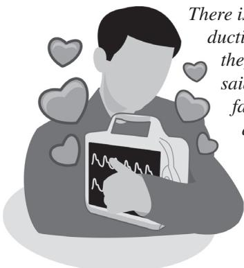

There is no prohibition against user interface designers conducting usability tests of their own designs, presuming that they have the expertise and objectivity to do so. That said, having designers test their own work may sacrifice face validity. This is unfortunate because user interface designers can bring in-depth knowledge to a usability testing effort and might even conduct a more effective device evaluation than “outsiders” who have a more superficial knowledge of the given interaction design issues of the device.

You have probably heard the saying, “The lawyer who represents himself has a fool for a client.” And, you might be familiar with the ethical policy that surgeons should not operate on a family member. So, should a user interface designer (individual or group) administer a usability test of his, her, or their own designs? The tone of this introduction suggests not. However, we think there are arguments in favor and against the practice.

One could argue that a user interface designer will be unable to conduct an objective usability test, that the designer will inevitably bias the test and guide its outcome, perhaps unwittingly. Alternatively, one might argue that a good user interface designer will be motivated to conduct the most objective usability test possible in pursuit of the best final design. Or, perhaps the designer’s motivation to produce the best design by conducting a sound test is akin to a pilot’s self-protective motivation to accomplish a safe landing.

Admittedly, we bring bias to the debate about the appropriateness of evaluating one’s own work because we do it a lot. We view usability testing as an essential step in the overall user interface design process and believe that it is efficient and effective for user interface designers to run their own usability tests, presuming an appropriate degree of competence. We are confident that we can be objective, like a journalist who reports on politics without introducing his or her own political views. But, we recognize that some people are more capable of such objectivity than others.

Economics is another factor in deciding if designers should also serve as test administrators. An in-house human factors group that handles user interface design and testing might be disinclined to seek testing support from an outside organization because it is expensive, among other reasons. On the other hand, a human factors consulting group might want to maintain creative control by conducting their own usability tests, which is also likely to increase their business volume. In such cases, a reasonable, compromising solution might be to have a colleague within the same consulting group conduct the usability test while the actual designers take notes or simply observe.

The vested parties will need to assess their comfort with having the user interface designers run their own usability test. Depending on the skills and demeanor of the people involved, testing could proceed well or poorly. Several issues related to skill, integrity, and efficiency come into play.

## Conducting the Test

Ultimately, we think that you should do what feels right with regard to selecting usability test administrators. If there are significant concerns about a particular designer’s objectivity, then expend the extra effort to engage an alternate testing team, whether they are closely tied to or disassociated from the designer. However, be sure to consider the benefits of having a designer conduct a test of his or her own designs. The designer might bring to bear extensive knowledge of the development of the design (and previously considered alternatives) and an enhanced ability to ask relevant follow-up questions.

## When and How Should You Assist Test Participants?

Keep in mind that a usability test is not a product demonstration. The goal is to have test participants perform tasks independently, at least until test participants reach an impasse. Therefore, test administrators should restrict their involvement to introducing tasks, prompting participants to keep communicating at appropriate times, and collecting data (e.g., ratings). However, there are times when test participants err or reach an impasse that calls for an intervention so that the test can move

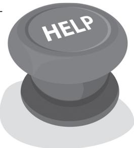

forward. Interventions might also be necessary to protect test participants from undue stress and fatigue. Test reports should cite such interventions.

Usability specialists should refrain from assisting test participants with directed tasks, at least for a while. After all, the point of usability testing is to observe representative users interacting naturally with a device and to identify its user interface design strengths and shortcomings, the latter of which are typically indicated by:

•	 Lengthy task completion times

•	 Incorrect actions (i.e., use errors)

•	 Requests for assistance

•	 Task abandonment (i.e., quitting)

•	 Indications of frustration, confusion, or declining morale

However, there comes a point when it is best to move forward rather than continue observing the test participant struggling to complete a task. Otherwise, you will waste time better spent exploring other user interface elements. Moreover, letting test participants struggle for too long might push them past their breaking point—a bad outcome that the proper implementation of a human subject protection plan should prevent.

Your options are to leave the current task incomplete or to provide just enough assistance to help the participant overcome the given obstacle. But, how do you know when it is time to exercise one of these options? During a formative usability test, you have more freedom to improvise (methodologically speaking). So, use your judgment to determine the time to move on, the point when you have learned as much as possible about the usability issue and its cause and there is little to be gained by asking the test participant to persevere. However, during a high-stakes summative usability test, you might want to preestablish a time limit (e.g., 3, 5, or 10 minutes) for each task, at which point you will either skip to the next task or provide a preestablished level of assistance. Providing assistance consistently will enable you to compare the performance of participants who received it. By comparison, providing ad-libbed assistance introduces a confounding variable. Keep in mind that an assisted task may be considered a failed task.2

It is reasonable to leave a task incomplete if subsequent tasks are not dependent on its completion, either in terms of the configuration of the medical device or the test participant’s ability to form an accurate mental model of the interactive characteristics of the device. If there are dependencies but there is insufficient time to let the test participant continue with the task, your options are to configure the device properly yourself (without the test participant watching is best) or to give the test participant the information necessary to move forward. For example, you might need to properly calibrate a gas sensor to continue with a gas measurement task. Or, you might simply need to tell the test participant, “Correct gas measurements depend on calibrating the sensors each time you turn on the device, such as each morning before use.”

The following scenarios illustrate how you might assist a struggling test participant:

## Scenario 1

Product: Infusion pump

Participant: Intensive care nurse

Task: Prepare the pump to infuse 500 milliliters of D5W to the patient at 150 milliliters/hour.

Scenario: The participant repeatedly tries to insert an infusion set into an infusion pump without success. Something seems to be blocking the set from sliding properly into its slot.

Assist 1 (after 5 minutes): “For safety reasons, the pump is currently preventing you from inserting the infusion set for safety reasons. There is another step you must complete before inserting the infusion set.”

Assist 2 (after 2 minutes more): “You cannot insert the infusion set without first activating the pump.”

Assist 3: (after 1 minute more): “The pump will not let you insert the infusion set until you turn the pump on using the switch on the back.”

## Scenario 2

Product: Emergency ventilator

Participant: Paramedic

Task: En route to an accident scene, prepare the ventilator for use on an adult male.

Scenario: The participant concludes that he has properly set up the ventilator for use. However, the sampling tube is not attached to its port.

Assist 1 (after the participant mistakenly assumed he completed the setup task): “The ventilator is not fully prepared for use. There’s more you need to do.”

Assist 2 (after 3 minutes more): “Check to see whether you made all of the necessary connections.”

Assist 3 (after 2 minutes more): “The ventilator samples the gas flowing through the Y-pipe. Check to see if you set up the ventilator to perform this function correctly.”

## Scenario 3

Product: Colonoscopy documentation software

Participant: Endoscopist

Task: Document the findings from a completed colonoscopy.

Scenario: The participant explores various on-screen menu options, looking for the specific place to record the drugs she administered during the procedure.

Assist 1 (after 3 minutes): “You were searching in the correct menu. You should continue looking there.”

Assist 1 (after 2 minutes more): “There is one menu option you have not yet tried.”

Assist 3 (after 1 minute more): “Try selecting the menu option entitled ‘Reports.’”

When you assist a participant, you might want to provide positive feedback to keep his or her spirits up, but also encourage the participant to work as independently as possible on moving forward. For example, you might say, “Thank you for persevering. I’m going to offer you some assistance at this point, after which I’d like you to continue working independently.”

What if a participant says he or she would call the toll-free support line of the device manufacturer? We see this as a great opportunity to simulate a support line by having the test participant simulate calling the test administrator, data logger, or technical representative of the manufacturer. Or, have the participant call a real support line staffed by someone and see what happens.

Be sure to document the number of assists you provide, when you provide them, and the type of assistance provided (e.g., “Told participant she needed to complete one more step to set up the device,” “Told participant to select the ‘Reports’ menu option”). It can be helpful to summarize participants’ independence (or need for assistance) when categorizing task completion status. For example, set up your data collection worksheet to enable you to indicate whether the test participant

•	 Performed the task correctly

•	 Performed the task correctly (after X assists)

•	 Performed the task incorrectly

•	 Performed the task incorrectly (after X assists)

## Encouraging the Test Participant to Persevere

As you would expect, some test participants are more likely than others to work hard to overcome difficulties that arise while interacting with a medical device. It is a matter of personality as well as training and experience. Some test participants seem to regress quickly from giving tasks their best shot to declaring defeat after a meager effort and asking for help. In some cases, there is no going back, and the test session quickly loses its value; little is learned when you have to assist a test participant frequently. So, we try to push back a bit when a test participant is prone to giving up. In response to requests for assistance, we will reply:

•	 “I’d like you to persevere for a few more minutes, just as though you were at work and there was nobody available to help.”

•	 “I understand that you would not continue to try to perform this task in a real use scenario. However, it would help us a lot if you could keep working at the task.”

“Although it might make perfect sense to seek assistance in a real use scenario, our research methodology requires that we withhold assistance until we have learned as much as possible about the difficulties that people might face using the device. Just keep in mind that we are not judging your performance. We are judging the device and learning how to make it better for people like you. So, please forgive me if I withhold assistance until the point that we develop sufficient insights regarding the cause of any problems that you encounter.”

Conducting the Test

## Can You Modify a Test in Progress?

During formative testing, you can adjust the evaluated design or your testing approach to make testing more productive (i.e., help you identify and address as many usability issues as possible) as long as enough sessions remain to properly evaluate the incorporated changes.

Adjusting a summative test midcourse is also possible but more complicated due to the need to ensure a sufficient sample size and maintain methodological consistency among test sessions.

Consider this usability testing scenario:

1. You have completed a third (4 of 12) of the sessions in a formative usability test of a prototype medical device.

2. The same usability issue has arisen during each of the four test sessions, and it is a major one.

3. You think a quick change to the prototype (e.g., modifying the text in an on-screen instruction, refining an icon, or adding a small plastic tubing clip to a hardware model) will resolve the usability problem.

Is it okay to make the quick change? We think so, noting that formative usability testing is supposed to be a practical exercise to identify design strengths and opportunities for improvement. It is not supposed to be about matching the high standard of methodological purity required for clinical trials, for example. You just need to make sure that any midcourse adjustments to your testing approach, including changing the nature of the stimuli (e.g., revising a prototype), do not lead to false findings because you are drawing conclusions based on the data from too few test sessions. You also need to obtain the approval of the project stakeholders and properly document midcourse adjustments in the test report, comparing and contrasting the data from the participants who interacted with the device before and after you implemented the modification. If your test required IRB approval (see “Do Usability Test Plans Require Institutional Review Board Approval?” in Chapter 7), take care not to make changes that might expose test participants to new risks.

As stated in “How Do You Set Expectations?” in Chapter 5, it can be perilous to draw conclusions from one test session. Accordingly, it is critical that usability specialists collaborate with engineers, designers, and project managers, drawing together the domain and experiential knowledge necessary to assess whether a given issue will cause problems for other users. In some cases, an observed use error might be an artifact of a particular participant’s lack of attention to detail, for example.

In the scenario described, in which two-thirds of the test sessions were still to come, we would be comfortable modifying the prototype and collecting additional data from the subsequent eight test participants. We would be hesitant to make the change if we had completed most of the test sessions and had only a few sessions left

## The RITE (Rapid Iterative Testing and Evaluation) Method3

Some usability specialists advocate modifying a user interface after almost every formative usability test session. Microsoft Corporation’s Rapid Iterative Testing and Evaluation (RITE) method directs engineers and designers to make immediate design changes (implemented within an hour or so) in response to identified usability problems before continuing testing. The method does not specify the number of test sessions after which evident issues should be addressed, but rather the description suggests that one to three data points might be the right number to justify a design change. The RITE method calls for (1) test sessions scheduled an hour or so apart (to provide time for debriefing and prototype revisions), (2) rapid solution identification, (3) rapid decision making, and (4) developers present to make changes with the required rapidity. This approach can be an efficient way to make improvements during the early stage of user interface design when prototypes and mock-ups are easy to change and be less practicable at a later stage when working models are more difficult to change. This methodology is probably more applicable to software user interface development than hardware user interface development. However, slightly larger gaps between test session clusters might be enough time to rapidly prototype hardware elements using 3-D printers, for example. Moreover, it might be equally simple to change a virtual hardware solution shown on a computer screen as it is to change a traditional software user interface.

from which to judge the effectiveness of the modifications. In this case, along with prototype modifications, we might recruit a few more participants to increase the data count to five or more.

If you are not 100% certain that a specific design modification will resolve the identified usability issue, consider having participants interact with both the current and modified designs. For example, have participants use the current design during the normal testing workflow and then repeat a task using the modified design toward the end of the test session. Alternatively, counterbalance the presentation order within the normal testing workflow to account for learning effects and other potential performance-shaping biases. These approaches will enable you to collect participants’ feedback regarding the design change and its effectiveness (or lack thereof) when compared to the design being tested.

Similarly, we might be comfortable changing the testing approach. For example, there might be value in switching from providing no training to providing a small amount of training to test participants if test sessions involving untrained participants were proving unproductive (i.e., test participants were all unable to progress through the initial setup task).

Midcourse adjustments are more complicated during a summative usability test. A summative usability test is hardly the time for design iteration. Continuing with design iteration at this stage suggests redefining the summative test as another formative usability test. Because a summative usability test is often a gateway on the critical path toward clinical trials or the product launch, testers might feel pressured to modify the device or testing approach to ensure that the validation effort is completed. In such cases, the feasibility of continuing with a modified testing approach becomes a numbers game.

In “What Is An Appropriate Sample Size?” in Chapter 8, we state that design validation typically requires performance data from at least 15 test participants (assuming a homogenous user population). Now, let’s assume you have started a test involving 25 participants (10 more than the minimum), primarily because you seek performance data and feedback from a reassuringly larger sample. Planning a larger than necessary test has the added benefit of enabling you to make mid-course design changes if they become necessary due to observed use errors and usability problems. In principle, you could make design changes through the tenth test session because you could still attempt to validate your design over the remaining 15 test sessions. If you think you might need to make a mid-test adjustment, consider scheduling a break in the testing schedule when you will decide whether to make a change. If you make a change, you can either describe the change in the test report and segregate the data from sessions involving the original and modified designs, or declare the first test sessions to be the final, formative usability test and report those results separately from the summative usability test to follow, immediately as it turns out.

## Can You Reliably Detect Use Errors?

During a usability test, some user errors are readily apparent. A test participant presses the wrong on-screen button or connects a tube to the wrong port. Test administrators can create checklists to help document these use errors. Other use errors, such as mental math errors, are more difficult or impossible to observe, so it is important to ask users if they recall committing any use errors, particularly those that could place themselves or others at risk. This two-pronged approach should help test administrators detect most use errors but has inevitable shortcomings, which is why developers need to take additional steps to identify potential use errors.

Some use errors, such as attaching a gas line to the wrong wall gas outlet, are easy to detect. You just have to watch what the participant is doing or inspect the final setup. Other use errors, such as silently misreading a numerical value on a vital signs monitor, are difficult to detect. In the last scenario, you would need extrasensory perception (ESP) to detect the use error immediately because it does not reveal itself overtly, at least not right away. The best you can do is to watch for signs of confusion and follow up with the right questions (e.g., “What are you thinking?”) to reveal the use error, if the user is even aware of committing one. Therefore, the reliability with which usability specialists can detect certain use errors is limited.

One strategy to increase the reliability of use error detection is to watch for them during test sessions. For example, suppose you are testing a nebulizer, such as one used in an emergency department to deliver medication to a patient experiencing a severe asthma attack. Hypothetically, the possible use errors include:

•	 Failing to disinfect the mask before placing it onto a simulated patient

•	 Filling the medication chamber with too much medication

•	 Filling the medication chamber with too little medication

•	 Filling the medication chamber with the wrong medication

•	 Connecting the gas hose incorrectly

•	 Failing to connect the gas hose

•	 Assembling the nebulizer incorrectly

•	 Failing to tighten the face mask straps

•	 Positioning the face mask straps incorrectly on the patient’s head

•	 Connecting the medication chamber cap insecurely

•	 Kinking the gas hose

Note that some of these use errors would be obvious (e.g., overfilling the medication chamber). However, some would be hard to detect (e.g., not fully tightening the medication chamber cap) without inspecting the nebulizer after the setup task. So, you would want to allot time in the schedule for such inspections, performed subtly or out of the test participant’s view so that you do not bias the test participant’s subsequent interactions with the device. We sometimes ask participants to take a break and step out of the test room so we (or development staff members supporting the test) can perform an inspection, explaining that we need to prepare for the next task. If you create a use error checklist to guide your inspections, include it in the test plan. The checklist will give the test plan reviewers—potentially including regulators—confidence that you have a strategy for detecting use errors with a modicum of reliability.

Another strategy to increase the reliability of error detection is to perform a posttest analysis of video footage from the test. Such an analysis, which can prove more fruitful if you capture footage from multiple camera angles, can reveal task performance details that would escape notice when observed in real time (and potentially from some distance away from the participant). However, analyzing video footage is time consuming, tedious, and best reserved for usability tests warranting such detailed analysis and if an intensive video footage analysis is likely to generate useful findings. For example, you might want to perform such an analysis of video recordings of physicians using a surgical instrument at a rapid pace that defies detailed inspection in real time.

A third strategy is to enlist the test participants’ help recollecting any use errors. Specifically, after a test participant completes a single task, or perhaps all of the planned tasks, ask him or her, “Do you recall committing any use errors, or experiencing any close calls, while interacting with the device?” Test participants are usually eager to review what went wrong and explain the causes (sometimes presented as excuses) and effects. Notably, if test participants are thinking aloud while interacting with the device, their commentary will likely help you identify points of confusion and uncertainty and when participants might have committed a use error (or thought they did).

Asking participants to recall use errors at the end of the test session might reduce the likelihood of obtaining useful insights due to the amount of time and the number of tasks performed since the use error occurred. However, asking such questions after each task might bias subsequent task performance by making participants hyperaware of the potential to commit a use error. You need to consider these and other trade-offs when deciding whether and when to ask participants to reflect on potential use errors.

We could assert that applying all of the error detection strategies discussed will identify all significant use errors. However, some use errors might still go undetected. That is the reality of usability testing, which is why medical device developers should continue to access usability during clinical studies and after product launch (i.e., as part of their postmarket surveillance efforts).

## Can You Give Test Participants Training?

If a device will be used by trained users, then training participants prior to a usability test will increase the realism of the test and provide more legitimate and useful results. However, it is important to be careful about how and to what extent you train the test participants.

The question of whether you can give test participants training has plagued many usability testers, whose instinct is to withhold training test participants to ensure the most rigorous evaluation. The common presumption is that untrained users will encounter, and therefore expose, more barriers to effective interactions with use of a given device. Similarly, there is an expectation that use errors are more likely to occur with untrained users.

We have found this to be generally true. However, the instinct to withhold training can be counterproductive and lead other product development professionals to view usability specialists as overly rigid and unrealistic or, worse, as unwitting saboteurs. Furthermore, testing only untrained users might cause the testing team to overlook usability issues that might arise due to training inadequacies.

In the medical domain, it is usually best to optimize a device for long-term rather than first-time ease of use. Designing a device to ensure initial ease of use by an untrained user can sacrifice long-term usability. Consider a left ventricular assist device controller or robotic surgical system. A clinician spends many hours learning to use the device in simulations and exercises before using it on a patient. It would almost certainly be considered malpractice for a clinician to use such a device without some training. So, testing the walk-up intuitiveness of such a device alone would be misguided. Covering the bases by testing both intuitiveness and long-term usability makes more sense.

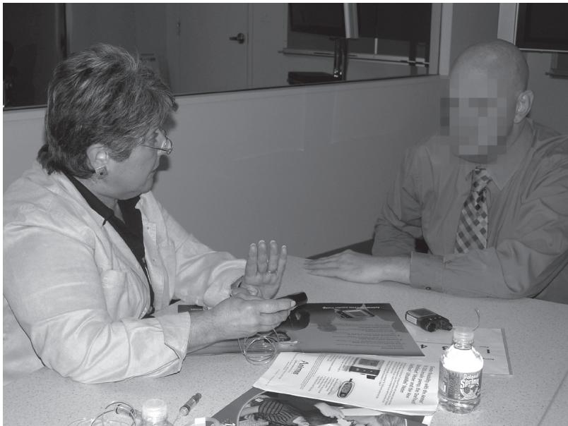  
Figure 12.8 A diabetes nurse educator trains a usability test participant prior to testing.

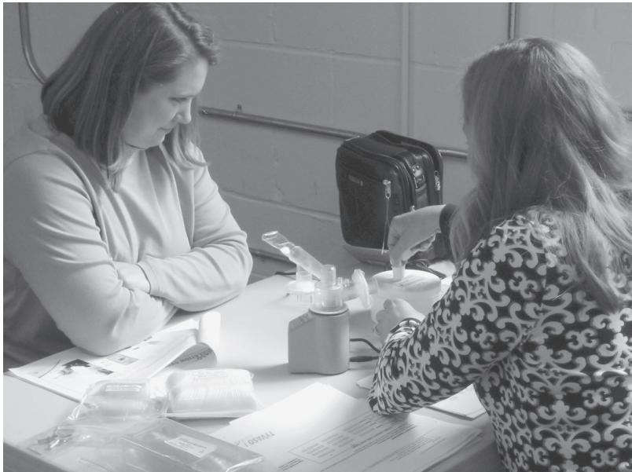  
Figure 12.9 A nurse educator trains a pilot test participant to set up a nebulizer.

Ultimately, you need to determine if the great majority of users in the field will be trained before using the device. If training is a real-world requirement rather than hypothetical prerequisite for device use, it makes sense to give test participants some training before a usability test. If at least some users will not be trained, such as nurses from a temporary agency who may encounter devices on the medical/surgical unit of a hospital for the first time, your usability test protocol should account for this. For example, if you are conducting a formative usability test involving 12 participants, you might choose to train only half of them. Untrained participants can also serve as surrogates for users who receive training but then forget what they learned, perhaps because they do not get to apply their newly acquired knowledge and skills for weeks, months, or even years.

Choosing an appropriate amount of training is the next challenge. Suppose a nurse would normally attend a half-day course on using a ventilator. Do you require them to attend (or have attended) such a course—and be formally certified to use the device prior to test participation? Maybe this is so if course attendance or certification is a formal or de facto requirement in most care settings. But, what if you are conducting a formative usability test of a brand new device and training materials have not been developed yet? This is when common sense should prevail. You can deliver some “placeholder” training, which might be as simple as providing participants with a verbal “primer” on the primary functions, interaction mechanisms, and associated domain knowledge (e.g., “gas XYZ” causes vasodilation) of the device. You might

even walk users through all of the tasks they will perform during the usability test.   
This hands-on training would mirror what happens during some in-services.

Whenever you provide training to a test participant, you should allow some time to pass (i.e., insert a “decay period”) before conducting the associated usability test session. That way, the test will focus less on the test participant’s near-term memory and more on the intrinsic usability strengths and shortcomings of the medical device.

In our practice, we will wait at least an hour after completing training before starting a test session, and we prefer to wait several hours or even days. When evaluating an implantable drug pump programmer, we waited 2 weeks. Such delays can complicate recruiting because they require participants to commit more time to the combined training and test event and possibly to come to the test facility on two separate occasions. But, the two-stage research effort is worthwhile. The decay period realistically models what can happen when someone learns to use a device in an in-service but then does not apply what he or she learns in an actual case until much later.

Here are some training guidelines:

•	 Deliver training in a representative manner for the type of device tested.

•	 If possible, have actual trainers deliver the training.

•	 Do not deliver better-than-normal training to boost the participants’ performance in the usability test.

•	 Encourage test participants not to practice what they learned in training prior to the test session.

•	 Do not send the trained participant home with training materials or the device under evaluation unless follow-up independent study is the norm.

•	 Consider including some test participants who receive minimum training.

Another approach is to conduct a two-stage usability test. During the first stage, you evaluate walk-up intuitiveness, regardless of whether most users would typically receive training. Then, you provide training and conduct further testing after an appropriate decay period. If users are required to receive training before using the device in the field, the first-stage testing can still provide useful insights into how to improve the device.

If you decide to train test participants, you will have to decide if you are going to give the trainees some type of competency test. We advocate competency testing when trainees would not be permitted to use the device without passing such a test or exhibiting a certain level of comprehension in the real world. Otherwise, a competency test would be unwarranted. A competency test might require trainees to answer a set of questions or demonstrate a set of tasks. It is important to establish and apply realistic pass/fail criteria. Creating unrealistically high passing criteria will make it difficult to qualify people to participate in the usability test and will create the appearance of “cherrypicking,” or consciously or unconsciously qualifying only the most capable individuals for the test.

## What Is an In-Service?

An in-service is a training event, sometimes delivered by a representative of a device manufacturer in a clinicians’ lounge during the lunch hour as attendees eat pizza (plain and pepperoni for sure). In about 30–60 minutes, the “rep” tries to convey the essentials about using the given device safely and effectively. Sometimes, attendees get a chance to try using the device. Ideally, the rep delivers multiple in-services so that staff working on various shifts and days can attend. However, a single event is more common. Also, new staff who start work some time after the in-service or perhaps return from vacation need to learn to use the given device from their colleagues, who might offer better, similar, or lower-quality training. Usually, most users at a given site will be trained in the last fashion unless the device manufacturer regularly conducts refresher training events. It is more common for manufacturers to “train the trainers,” leaving the task of future training to the clinical staff of the customer. While some institutions require clinicians to receive training prior to using a particular device, others do not. In addition, some institutions administer posttraining competency checks, while other do not. At some hospitals, it is enough for a clinician’s name to appear on an in-service attendance list.

## Should You Provide Access to Learning Tools?

Learning tools, such as a user manual or quick reference card, may provide critical guidance to users—particularly new ones—or may be largely ignored. Learning tools are bound to be more useful if task oriented and well written and if they are kept with the associated medical device. To explore the “worst-case” use scenario of a medical device, you might choose to withhold learning tools as though they were lost, as is prone to happen to printed documents. Otherwise, to maximize task realism, you should provide users with the normally available learning tools, be they documents or digital resources such as online help.

How do you decide if you should provide usability test participants access to the learning tools of a medical device, such as a quick reference card or user manual? Here is a simple approach. Ask yourself whether users would normally have immediate access to such learning tools. If the answer is yes, you should probably make the tools available if you want to assess the real-world performance of the device. Users will then have the option to use them or not. Otherwise, by withholding the resources, you distort reality and make it harder than usual for test participants to perform tasks. If users might not normally have immediate access to the learning tools, then making them available could have the opposite distortional effect. The availability of the tools could make user interactions easier than usual, thereby producing false-positive findings.

But, here is an important caveat. There are benefits associated with making participant-device interactions harder than usual during certain types of usability tests. Some usability tests are intended to be “pressure,” “stress,” or “drop” tests during which you create worst-case scenarios to see how a user interface design might fail, the goal being to identify (and subsequently resolve) design shortcomings and make the final device design as intuitive as possible. During such rigorous tests, denying access to learning tools is consistent with the goal of creating a worst-case but realistic use scenario. For example, an infusion pump might normally have a laminated quick reference card chained to it. However, an inexperienced nurse might be working independently with the pump during the night shift and discover the card missing, thereby finding himself or herself in a use scenario that is more challenging than usual.

Some medical devices provide ready access to learning tools. For example, a given device might have instructions printed right on its outer shell, a quick reference card chained to its handle, a user manual placed in a dedicated slot in its base, or an online help system. Other medical devices might not. The learning tools might be kept in a central location that is relatively far from the point of patient care (e.g., at the nurses’ station or in a supply closet). Devices intended for use by laypersons, such as glucose meters, typically come with a user manual and quick reference card that might be kept close at hand—placed in a bedside table drawer, for example—or eventually misplaced.

In principle, an extremely intuitive user interface should not require learning tools. Many people cite the iPod as a good example of an intuitive-to-use device that relieves users from having to read about how to use it. In fact, we (the authors) all have iPods and have rarely consulted the user manual. While we might not be familiar with some of the fancier functions of the device, we are all able to upload and listen to music without a problem. Some medical devices, such as digital thermometers, call for this level of intuitiveness. However, complex diagnostic and therapeutic machines, such as magnetic resonance imaging (MRI) scanners, do not, even though their designers might aspire to achieve such intuitiveness. Therefore, when evaluating complex medical devices that require lots of specialized knowledge, you probably want to provide test participants with the usual learning tools rather than withhold them. We think this is the way most regulators reviewing a usability test plan would see things as well.

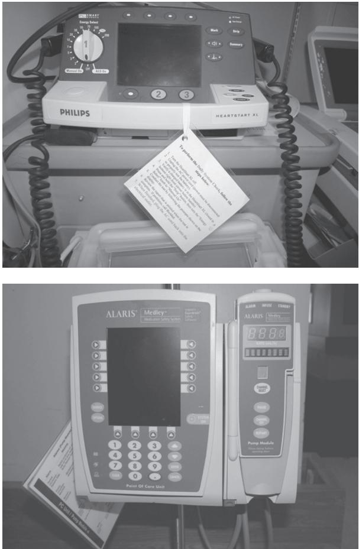  
Figure 12.10 Quick reference cards attached to a defibrillator (top) and infusion pump (bottom).

When learning tools become available, they might be in draft form. This creates the potential for learning tools with deficiencies to misguide device users, making it seem like there are user interface design flaws rather than problems with the supporting materials. Therefore, be sure that draft learning tools are “scrubbed” as clean as possible before you give them to test participants.

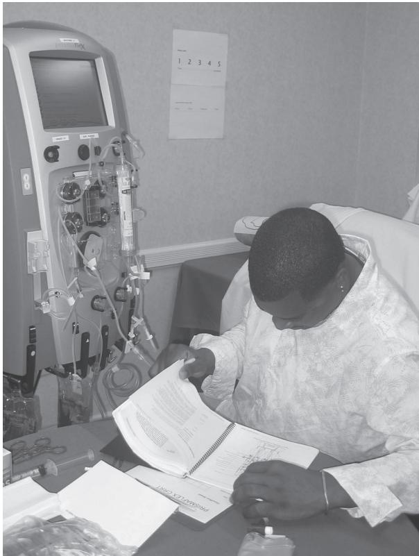  
Figure 12.11 A usability test participant refers to the user manual of a dialysis machine.

Sometimes, the best testing approach is to give test participants access to the learning tools only after a period of device use without them. For example, you can have test participants perform basic tasks using their intuition and then grant them access to the learning tools while performing a broader set of tasks. Alternatively, you might have participants perform intuition- and instruction-based trials of the same task. We often find it quite valuable to have participants set up a device based on their intuition before using the learning tools to repeat the task. Taking this approach, you can judge the intuitiveness of a given device independent from the learning tools before judging its ease of use (and the effectiveness of the learning tools) when the tools are available.

Note that some users might take full advantage of available learning tools, while others might not. The choice to use them is partly a matter of individual learning style. Some people like to read about devices before using them, while others prefer to follow their intuition and resort to reading instructions only when they reach an impasse. We usually invite test participants to utilize available learning tools as they see fit. This leads some test participants to use them right away and others to disregard them. On occasions when we know that real-world users will depend heavily on a user manual and we want to evaluate its quality in conjunction with device use, we direct the test participant to follow the user manual. For example, we might ask a test participant to follow the step-by-step instructions provided to perform a complex troubleshooting task involving hardware disassembly and reassembly.

Of course, providing learning tools to test participants presupposes that the tools exist. In reality, learning tool development often trails user interface development, the notion being that you do not bother to develop the tools until the user interface is nearly done. Consequently, there might not be any learning tools to share with the test participants. In such cases, you might want to provide test participants with a functional overview in a written or spoken form, taking care to provide enough information to make the test productive but leaving plenty for test participants to discover and discern on their own. For example, an introduction to an infusion pump provided in place of access to learning tools might read as follows:

“You will be interacting with a prototype infusion pump. It is a single-channel pump that also enables you to deliver secondary or so-called piggyback infusions. Normally, you might have attended a 20- to 30-minute in-service to learn to use the pump or at least read its quick reference guide or excerpts from the user manual. Today, we are asking you to perform tasks without the benefit of any in-service training or such learning aids. Accordingly, I will share a few details about the basic operation of the pump.

“The pump is intended for use in low-acuity and will mostly be used to provide fluid support and deliver antibiotics and mild analgesics. Its integrated touch screen enables you to press on-screen buttons to select and control certain actions. You will see that there are additional on-screen controls to adjust various infusion parameters. In some cases, you will need to slide your finger across the screen to make adjustments.

“The device runs on AC or battery power. You can lock the screen to prevent the pump from unauthorized use. The code to unlock or activate the screen is the current year: 2-0-1-0. The pump has a built-in dose calculator. The pump also keeps a log of all infusion program adjustments. Using a wireless Internet connection, the pump can download patient information from and upload drug delivery records to the computer network of the hospital. You cannot program an infusion until you have installed the disposable infusion cassette.”

You will have to decide if this level of orientation is appropriate. Clearly, there is no need to orient test participants if they are unlikely to receive an introduction prior to encountering a given device for the first time.

## Notes

1. Collaborative Institutional Training Initiative (CITI). 2008. Basic Institutional Review Board (IRB) regulations and review process. Page 7. Retrieved from https://www.citiprogram.org/

2. U.S. Food and Drug Administration (FDA). 2010. Presentation by Ron Kaye: Human factors/usability for infusion pumps: Additional test data requested in new draft guidance. FDA Workshop on Infusion Pumps, slide 21. Retrieved from http://www.fda.gov/ downloads/MedicalDevices/NewsEvents/WorkshopsConferences/UCM219683.pdf

3. Medlock, M. C., Wixon, D., Terrano, M., Romero, R., and Fulton, B. 2002. Using the RITE method to improve products: A definition and a case study. Usability Professionals Association, Orlando, FL, July.