# 1 Introduction
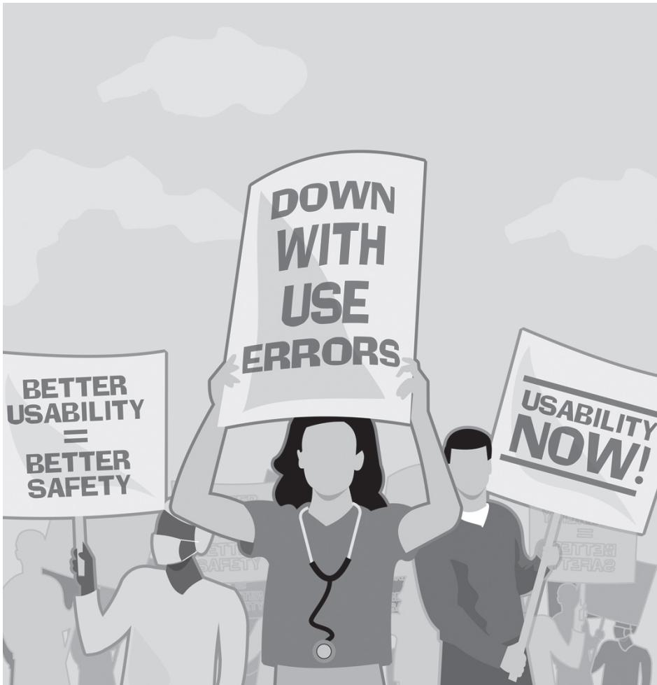

## What Is Usability Testing?

Usability testing calls for representative users to perform representative tasks as a means to reveal the interactive strengths and opportunities for improvement of a device. You can think of the activity as pressure testing or debugging the user interface of a device in terms of how it serves the users’ needs, a critical need being safe operation. Tests may focus on early design concept models, more advanced prototypes, and even production units. A two-person team usually collaborates to run test sessions with one participant at a time. Good practice calls for preparing a detailed usability test plan and report that can be added to the design history file of a device.

Usability testing is a means to determine whether a given medical device wil meet its intended users’ needs and preferences. By extension, it is a way to judge if a medical device is either resistant to or vulnerable to dangerous use errors that could lead to user or patient injury or death.

In its classic form, a usability test takes place in a special-purpose facility—a usability test laboratory—where test administrators can direct test activities from within one room while interested parties observe from an adjacent room via a oneway mirror. In practice, however, you can conduct a usability test in a wide range of environments, including equipment storage rooms, nurses’ lounges, conference rooms, hotel suites, focus group facilities, medical simulators, and actual clinical settings such as an operating room.

The purpose of any usability test is to have test participants perform tasks with the given medical device, be it an early prototype, working model, production-equivalent device, or marketable device. If the medical device were a patient monitor, test participants might connect a simulated patient’s sensor leads to the monitor, print an electrocardiogram (ECG) tracing, “shoot” a cardiac output measurement, and adjust the systolic and diastolic blood pressure alarm limits. If the medical device were an endoscope, test participants might place the endoscope into a simulated digestive tract, move the scope through the esophagus and into the stomach and up to the pyloric sphincter (valve), and then place the scope in a retrograde orientation to visualize the lower esophageal sphincter. If the medical device were an insulin pump, test participants might program a basal rate profile calling for different insulin delivery rates at each hour of the day, look up the carbohydrate content of a baked potato, deliver an eight-unit bolus before mealtime, and upload a month’s worth of data to a computer for subsequent trend analysis. Importantly, the insulin pump would not be attached to the test participant (as it would be to an end user, who is using the device to administer insulin). Rather, tasks involving insulin delivery would be simulated, and if the participant needed to fill the device with insulin, inactive fluid such as saline or plain water would typically be used in its place. As suggested by the examples, usability testing of medical devices typically does not involve actual patients receiving treatment or taking active medications.

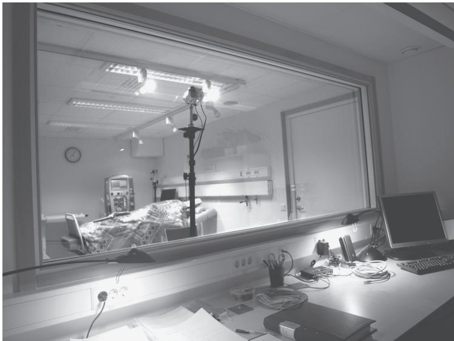  
Figure 1.1 A conventional usability testing lab equipped with a one-way mirror.

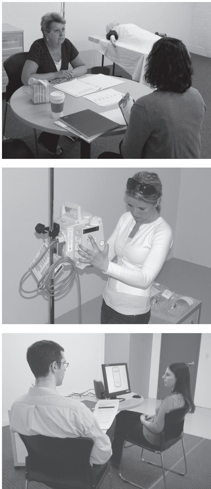  
Figure 1.2 Scenes from usability tests of various medical devices.

While test participants perform tasks, test personnel—typically a test administrator and note taker—observe intensively to determine how the medical device facilitates or hinders task completion. In addition to documenting observed use errors, test personnel might record data such as task times, test participants’ comments, and various subjective design attribute ratings, such as ease and speed of use (see “What Data Should You Collect?” in Chapter 14).

If you are testing a fairly simple device, test sessions might breeze by in as little as 30 minutes. However, most test sessions last between one and 2 hours, providing enough time to properly orient the test participant to the test environment, purposes, and ground rules; to perform hands-on tasks; and to interview the test participant about the strengths and opportunities for improvement of the design, for example. A half-day test session is not unreasonable if the device under evaluation requires one individual to perform an extensive number of tasks (e.g., unpacking, assembling, calibrating, operating [in multiple modes], and servicing) (See “What Is the Proper Duration of a Test Session?” in Chapter 5 for more information about determining the appropriate test session length.)

Usability specialists (or allied professionals responsible for conducting the test) write detailed test plans to guide effective, consistent, and objective design assessments. After completing a test, analyzing the data, and developing findings, the test administrator reports his or her findings with the required level of detail and formality. A sometimes-lengthy narrative test report that describes the purpose, approach, and participants of the test and presents an analysis of the data, findings, and recommendations is a common final product that medical device developers can add to their design history file and submit to regulators.

Medical device developers are well served to conduct formative usability tests “early and often” during device development to assess design alternatives and identify opportunities for design improvement. Later in the design process, developers are essentially required to conduct a summative usability test to demonstrate that their medical devices are safe to use from an interaction design standpoint. During either type of test, users’ interactions with the given medical device might proceed smoothly, suggesting that the design is on the right track or even ready for market introduction. Conversely, testing might reveal usability problems that could, should, or must be corrected prior to the release of the device.

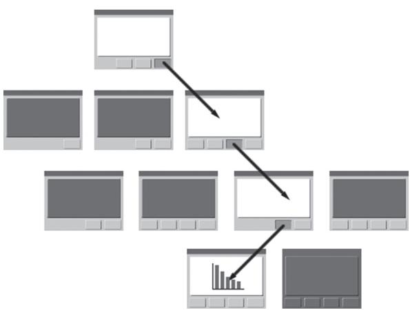  
Figure 1.3 A sample user interface structure with a task sequence shown.

Usability tests usually involve a small number of test participants compared to market research studies and clinical trials, for example. An informal test involving just a few test participants can be productive. However, sample sizes in the range of 8 to 25 test participants are the norm (see “What Is an Appropriate Sample Size?” in Chapter 8), the mode being around 12–15. No matter the population sample size, the key is to get the right test participants. This means recruiting a sample of test participants who represent a good cross section of the people who will actually use the given medical device. That said, usability specialists sometimes skew the sample so that it includes an above-average proportion of people with limitations (i.e., impairments) that could affect users’ ability to use the device. Skewing the sample in this way helps usability specialists detect potentially hazardous use errors that unimpaired users might not necessarily commit. Moreover, taking such an approach helps to determine the accessibility and usability of a medical device by people with impairments.

All sorts of usability problems can arise during a usability test (see “What Kinds of Usability Problems Arise during a Usability Test?” in Chapter 12). For example, it is not unusual to see test participants go down the wrong path within a software screen hierarchy because menu options are poorly worded or because information and controls of interest are oddly placed. Sometimes, test participants get stuck on a task because on-screen or printed instructions are incomplete, incorrect, or unclear. Also, test participants might press the wrong button because they misinterpreted its iconic label or because it was small and too close to other buttons.

Plenty of good things can happen during a usability test as well. For example, test participants might correctly set up a device for use on their first try without training—a harbinger of good usability across the spectrum of possible user tasks. They might execute a therapeutic procedure in the exact order prescribed by the on-screen prompts. And, referring to a quick reference guide, test participants might properly interpret an on-screen and audible alarm and quickly perform the troubleshooting steps required to resolve the underlying problem.

Accordingly, usability testing is about discovering the good and bad aspects of a user interface for the purposes of design refinement and validation. Programmers might think of usability testing as a method of debugging a user interface from a user interaction standpoint. Mechanical engineers might liken usability testing to pressure testing or metaphorically dropping a user interface onto a concrete floor from a considerable height. And, begging your pardon for one more comparison, we liken usability testing a user interface to a doctor giving a patient a physical—an inspection that usually shows most things are normal (i.e., in order) but highlights a few areas for improvement.

## Introduction

## What Is a Medical Device?

A medical device is a product used to diagnose, treat, or monitor a medical condition. Given this broad definition, regulators group medical devices into different classes based on the complexity and inherent potential of a given device to cause patient harm. Depending on the class of a given medical device, more or less human factors engineering will be warranted.

We all have a general understanding of the term medical device. A medical device is something that physicians, doctors, nurses, technicians, and even laypersons use to diagnose, treat, or monitor a medical condition. Moreover, we think of a device as a physical item that might also incorporate a software user interface. Medical devices vary widely in terms of their size and purpose.

A syringe and a magnetic resonance imaging (MRI) scanner are both medical devices. So are exam gloves and cardiopulmonary bypass machines. However, as will be discussed, medical devices fall into different classes. You can conduct a usability test of virtually any medical device. However, manufacturers of Class II and Class III devices are likely to invest more efforts into usability testing because their devices have a greater potential to harm someone if operated improperly.

The Food and Drug Administration (FDA) defines a medical device as follows:

An instrument, apparatus, implement, machine, contrivance, implant, in vitro reagent, or other similar or related article, including a component part, or accessory which is:

•	 recognized in the official National Formulary, or the United States Pharmacopoeia, or any supplement to them

•	 intended for use in the diagnosis of disease or other conditions, or in the cure, mitigation, treatment, or prevention of disease, in man or other animals

intended to affect the structure or any function of the body of man or other animals, and which does not achieve any of its primary intended purposes through chemical action within or on the body of man or other animals and which is not dependent upon being metabolized for the achievement of any of its primary intended purposes1

In Council Directive 93/42/EEC, the European Union offers the following definition:

“Medical device” means any instrument, apparatus, appliance, material or other article, whether used alone or in combination, including the software necessary for its proper application intended by the manufacturer to be used for human beings for the purpose of:

•	 diagnosis, prevention, monitoring, treatment or alleviation of disease

•	 diagnosis, monitoring, treatment, alleviation of or compensation for an injury or handicap

•	 investigation, replacement or modification of the anatomy or of a physiological process

•	 control of conception

and which does not achieve its principal intended action in or on the human body by pharmacological, immunological or metabolic means, but which may be assisted in its function by such means.2

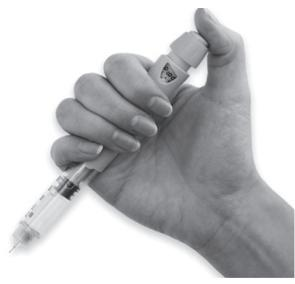

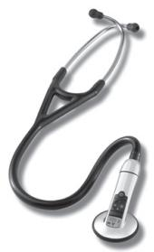

Usability Testing of Medical Devices

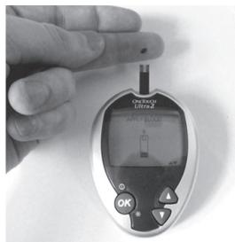

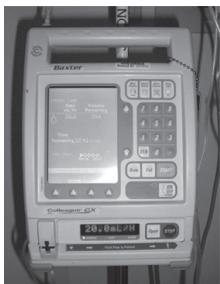

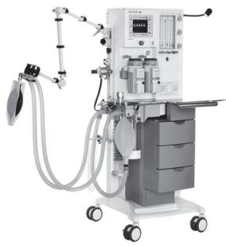

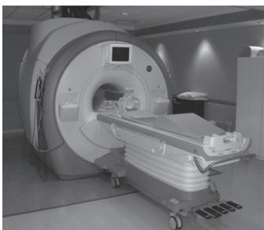  
Figure 1.4 Medical devices vary widely in terms of shape, size, function, complexity, and usage. Photos (clockwise from top-left) courtesy of Industrial Design Consultancy, 3M, David Ivison, BrokenSphere, HEYER Medical AG, and Waisman Laboratory for Brain Imaging and Behavior.

The FDA recognizes three medical device classes:3

## Class I: General Controls

“Class I devices are subject to the least regulatory control. They present minimal potential for harm to the user and are often simpler in design than Class II or Class III devices. Class I devices are subject to “general controls,” as are Class II and Class III devices.

“General controls include:

1. Establishment of registration of companies, which are required to register under 21 Code of Federal Regulations (CFR) Part 807.20, such as manufacturers, distributors, repackagers, and relabelers.

2. Medical device listing with FDA of devices to be marketed.

3. Manufacturing devices in accordance with the good manufacturing practices (GMP) in 21 CFR Part 820.

4. Labeling devices in accordance with labeling regulations in 21 CFR Part 801 or 809.

5. Submission of a premarket notification [510(k)] before marketing a device.

“Examples of Class I devices include elastic bandages, examination gloves, and handheld surgical instruments. Most Class I devices are exempt from the premarket notification and/or the GMP regulation.”

## Introduction

## Class II: Special Controls

“Class II devices are those for which general controls alone are insufficient to ensure safety and effectiveness, and existing methods are available to provide such assurances. In addition to complying with general controls, Class II devices are subject to special controls. . . . Special controls may include special labeling requirements, mandatory performance standards, and postmarket surveillance.

“Examples of Class II devices include powered wheelchairs, infusion pumps, and surgical drapes.”

## Class III: Premarket Approval

“Class III is the most stringent regulatory category for devices. Class III devices are those for which insufficient information exists to ensure safety and effectiveness solely through general or special controls.

“Class III devices are usually those that support or sustain human life, are of substantial importance in preventing impairment of human health, or that present a potential, unreasonable risk of illness or injury.

“Premarket approval is the required process of scientific review to ensure the safety and effectiveness of Class III devices. Not all Class III devices require an approved premarket approval application to be marketed. Class III devices that are equivalent to devices legally marketed before May 28, 1976, may be marketed through the premarket notification [510(k)] process until the FDA has published a requirement for manufacturers of that generic type of device to submit premarket approval data.

“Class III devices that require an approved premarket approval application to be marketed are those:

1. Regulated as new devices prior to May 28, 1976, also called transitional devices.

2. Devices found not substantially equivalent to devices marketed prior to May 28, 1976.

3. Class III preamendment devices that, by regulation in 21 CFR, require a premarket approval application.

“Examples of Class III devices that require a premarket approval include replacement heart valves, silicone gel-filled breast implants, and implanted cerebella stimulators.

“Class III devices that can be marketed with a premarket notification 510(k) are those:

•	 Postamendment (i.e., introduced to the U.S. market after May 28, 1976) Class III devices that are substantially equivalent to preamendment (i.e., introduced into the U.S. market before May 28, 1976) Class III devices and for which the regulation calling for the premarket approval application has not been published in 21 CFR

“Examples of Class III devices that currently require a premarket notification include implantable pacemaker pulse generators and endosseous implants.”4

## Why Conduct Usability Tests of Medical Devices?

Usability testing helps reveal opportunities to make medical devices easier, safer, and more efficient and pleasant to use. These improved interactive qualities benefit nearly everyone associated with a given medical device, especially the manufacturer, end user (i.e., caregiver), and patient.

The most profound reason to conduct usability tests of medical devices is to protect people from injury and death due to use errors. Too many people have been injured or killed because someone pressed a wrong button, misread a number, misplaced a component, skipped a step, or overlooked a warning message when using a medical device, for example. And, while usability testing will not catch every design shortcoming that could lead to a dangerous use error, it will catch many of them. Therefore, usability testing should be considered a moral imperative as well as a de facto regulatory requirement and commercially advantageous.

Usability testing has many beneficiaries:

Manufacturers. Usability testing can lead to user interface design refinements that are likely to increase device sales, engender customer loyalty, reduce the demand for customer support (e.g., calls to a hotline), extend the life span of a device, and reduce the chance of product liability claims. In short, it is good for business.

Customers. Usability testing benefits customers such as hospitals, clinics, private medical practices, and ambulance services in myriad ways. Easy-touse devices make workers more productive, improve worker satisfaction, reduce training and support costs, and improve patient care.

Caregivers. Usability testing also benefits caregivers (e.g., physicians, nurses, therapists, technicians, maintainers). Design improvements made as a result of usability testing are likely to make a device easier to learn and use, reduce the need for support, and empower caregivers to do their best work. Usable devices can even speed up work and enable caregivers to go home on time.

Patients. Finally and most important, usability testing benefits patients because they are less likely to be injured or killed by user interface shortcomings that induce caregivers to err. Sadly, thousands of people die each year due

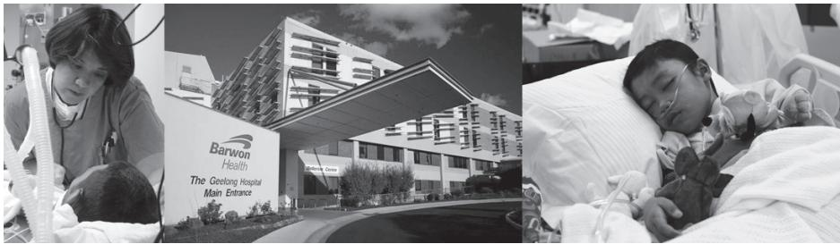  
Figure 1.5 Usability testing benefits many people in many ways. Center photo courtesy of Barwon Health

## Why Does the FDA Suggest Conducting Usability Tests?

The U.S. FDA recognizes usability testing as one of the methods manufacturers should use to generate design inputs and, moreover, to validate the design of a device. The FDA dictated that “Design validation shall ensure that devices conform to defined user needs and intended uses and shall include testing of production units under actual or simulated use conditions.”6 The FDA further discussed the importance of human factors engineering and usability testing in Do It By Design,7 a publication that defined usability testing as “a test of either an actual device or an advanced prototype with a fully functional user interface. Data obtained includes user performance (time, errors, and accuracy) and subjective responses of test participants” (p. 42). Another FDA publication, Medical Device Use-Safety: Incorporating Human Factors Engineering into Risk Management,8 described usability testing as a tool to identify potential use-related hazards.

to medical errors involving devices. For example, infusion pump programming errors (e.g., entering the number 80 instead of 8.0) have led to so many deaths that the industry coined the expression “death by decimal.”5 The application of human factors engineering and usability testing in device development helps reduce the use error rate and limit the consequences of use errors that do occur.

Another reason to conduct usability tests of medical devices—closely related to preventing patient injuries and deaths—is to meet the device regulators’ expectations. In short, usability testing is the predominant means to validate that medical devices meet users’ needs and are not subject to dangerous use errors. We address this topic extensively in “What Is the Relationship between Usability Testing and Risk Management?” in Chapter 2.

## What Are Common Regulator Comments on Test Plans?

Regulators encourage medical device manufacturers to conduct usability tests, and therefore prepare test plans, that focus on the riskiest user tasks. From a regulatory perspective, the ideal test plan will raise confidence that the ensuing usability test will reveal user interface design flaws that could lead to dangerous user errors, if any exist. Test plans that effectively link usability testing and risk management instill such confidence. Testing activities that are important but do not relate directly to device safety, such as evaluations focused chiefly on usability and appeal, should be marked as such.

Medical device manufacturers might choose to seek feedback on their usability test plans from regulators before proceeding with a summative usability test. For example, the Food and Drug Administration (FDA) might review a usability test plan on request and provide official comments via teleconference and letter, for example. Undoubtedly, responding appropriately to the feedback increases the chance that the regulatory agency will accept the revised usability testing approach. Of course, accepting the testing approach has little to do with accepting the test findings as evidence that the design is valid (i.e., safe for use).

Below is a sample of the feedback that manufacturers have received over the past few years via discussions with and through letters from regulators. Note that we have commingled comments on test plans and reports because they really address the same methodology issues in either a prospective versus retrospective manner, respectively.

Caveat: We have paraphrased and, in some cases, expanded the feedback for clarity sake. As such, the feedback is indirect and should not be regarded as regulatory policy. Moreover, various regulators might have different views on the issues addressed. Therefore, you should regard the feedback presented below as simply informative.

•	 Finding new use errors. Hypothesize the use errors that might occur during each task and consolidate them into an inspection checklist that the test administrators will use to evaluate participants’ interactions during the usability test. Include the checklist as an appendix in the test plan.

•	 Prioritizing. Identify and prioritize directed tasks based on risk analysis results.

Relating tasks to risk analysis results. Create a table delineating the identified risks and associated, directed tasks to show that usability test participants will perform the riskiest tasks (i.e., tasks subject to use errors that are most likely to cause harm). Also demonstrate that participants will perform tasks that serve to assess the effectiveness of risk mitigations such as protective design features, labels, warnings, and instructions for use.

•	 Including secondary tasks. Testing should include tasks such as cleaning, maintaining, and storing a device if these tasks are pertinent to the device’s safe use.

•	 Describe how you will evaluate the critical aspects of user interactions without having participants actually deliver or receive treatment using the device.

## Introduction

• Involving representative users. Describe how you will recruit a sufficiently diverse sample of prospective users, including “worst-case users,” such as marginally trained or even untrained users who might choose or be directed to use the device, and users with certain impairments.

•	 Involving “low functioning” users. Include “low functioning” individuals in the user population sample. Recruiting only “high functioning” individuals will not produce a representative sample of the intended user population.

•	 Involving people with low language proficiency. Include individuals who are less proficient in the device’s selected language (e.g., English), noting that the device might be used by individuals who have low proficiency in the selected language.

•	 Company employees serving as test participants. Avoid using company employees as participants in usability test.

•	 Providing training. Fully explain the need for and nature of any training that you plan to deliver to test participants.

•	 Providing prototype training. If a training program has not yet been established, it is acceptable to deliver what you consider to be an appropriate level of training.

•	 Access to training/learning materials. Test participants should be provided access to the training and instructional materials that would normally be available to them in an actual use scenario.

Allowing training benefits to decay. There should be a delay between training and testing that might, in a realistic manner, result in some “decay” in the knowledge and skills attained during training. The length of the delay should be based on real-world use scenarios.

•	 Population sample size. Include an appropriate size sample from each user group (e.g., ≥ 15 people per group for a summative usability test). Regulators seem less concerned about test sample size, although a minimum of 15 to 25 participants appears to be a good working number, subject to increase if the intended user population has segments with widely differing capabilities and use the given device in distinctive ways (see “What Is an Appropriate Sample Size?” in Chapter 8 for more information about selecting an appropriate sample size). Be sure your plan includes a sample size rationale. Regulators also seem less concerned about the test team members’ usability testing credentials and experience, focusing more attention on whether the team is proposing a high-quality testing approach.

Identifying outliers. Establish criteria for declaring a test participant as an “outlier” (see “How Do You Handle Outliers?” in Chapter 15) whose data should be excluded from posttest analyses. If providing participants with training before the usability test, establish criteria for disqualifying a test participant from participating in the subsequent usability test if he or she is unable to use the given medical device. For example, if a nurse-trainer determined that a current home dialysis patient—a candidate usability test participant—would not be able to safely use a dialysis machine at home, such an individual would not be an appropriate participant for a test of such a device.

Collecting data unrelated to use safety. Delineate the type of data you plan to collect and how you will analyze it to draw conclusions regarding the use safety of a given device. Be sure to differentiate between data you are collecting for the sake of validation (e.g., observed use errors, anecdotal comments related to device use safety) and to serve commercial interests (e.g., subjective ease of use and satisfaction ratings).

•	 Tracking difficulties and close calls. In addition to describing how you will detect and document use errors, describe how you will detect and document operational difficulties and close calls (i.e., cases in which users almost committed a user error).

•	 Value of subjective ratings. Ease of use ratings are supportive background information but not—on their own—a basis for validation. Meanwhile, subjective data such as ease of use ratings can help identify the occurrence and nature of close calls.

•	 Value of clinical findings. Clinical test results are valuable but not a replacement for usability test results. You need to conduct a usability test that focuses specifically on use-related risks, and then (if appropriate, such as in the case of infusion pumps) follow-up with usability studies conducted in the context of clinical use.

•	 Value of task times. Tasks times are only relevant when the speed of task performance is critical to safety, such as when a delay in treatment could place a patient at risk.

•	 Focusing on production-equivalent devices. Summative testing should be performed on a production-equivalent device, not an incomplete prototype or computer-based simulation.

•	 Analyzing use failures. Summarize how use errors will be addressed en route to determining if the device needs to be modified to reduce the likelihood of associated risks to an acceptable level.

•	 Protecting human subjects. Outline how you will ensure human subjects protection (see “How Do You Protect Participants from Harm?” in Chapter 13), including how you plan to protect participants from physical and emotional harm, minimize risks to the participant, and deidentify the test data.

•	 Performing tasks accurately. Explain how the test environment, scenarios, and directed tasks are reasonably representative of actual use conditions.

•	 Ensuring a realistic workflow. Specify tasks that participants can perform following a realistic workflow rather than asking participants to perform isolated steps in a potential distorted or deconstructed manner.

•	 Reporting results by user group. Test results should be segregated according to user group.

## When Should You Ask Regulators to Review a Draft Test Plan?

It is a good idea to ask regulators to review a draft test plan if it is the first time you are conducting a usability test of a medical device. It is also helpful to have

## Introduction

regulators review and comment on your test plan if (1) regulators have been dissatisfied with previous test plans or (2) if the upcoming usability test has particularly high stakes and having to repeat it to address regulatory concerns would create commercial jeopardy. If you seek regulators’ feedback, be sure to allot ample time in the project schedule for the review (ask regulators to estimate their response time) and to revise and resubmit the test plan, if necessary.

## Is Usability Testing of Medical Devices Required?

International standards bodies have made usability testing a de facto requirement. As a result, usability testing has become standard operating procedure among manufacturers that develop medical devices. Failing to conduct usability tests en route to a final design invites regulators to reject a manufacturer’s application for clearance to bring the device to market, citing insufficient use safety data.

At the time this was written (2010), usability testing of medical devices was not explicitly required by any government. Let us just say that it is strongly recommended, and medical device manufacturers create considerable exposure to regulatory roadblocks and liability claims if they do not conduct one or more usability tests during the medical device development process.

For many years now, usability specialists, regulatory bodies and their particular guidance documents, and industry standards have promoted usability testing as the chief means to ensure that medical devices meet users’ needs and do not induce dangerous user errors. Usability testing is not the only way to judge the interactive qualities of a device, so current regulatory and guidance documents do not come right out and state that manufacturers must conduct a usability test per se. But, there is a virtual mandate—a standard of care, if you prefer—to conduct usability tests. Moreover, it is hard to imagine alternative ways to assess specific interactive medical device qualities without asking representative users to perform tasks using a given device. It would be like assessing the battery life of a device without turning the device on and seeing how long it stays on.

The FDA infers the need for usability testing, without using the term, in its revised GMP regulation, released on October 7, 1996. The Code of Federal Regulations states:

Design validation shall ensure that devices conform to defined user needs and intended uses, and shall include testing of production units under actual or simulated use conditions.14

On its Web site, the FDA describes the human factors relevance of the design validation section of the CFR:

Human factors relevance: Design validation should be used to demonstrate that the potential for use error that can lead to patient injury has been minimized. The regulation requires testing the device under actual or simulated use conditions. Realistic use conditions, therefore, should be carried out by test participants who represent a range of typical intended users in terms of their ability to acquire information from, manipulate and maintain the device and understand the accompanying labeling.15

The FDA provided further encouragement to manufacturers to conduct usability tests as a means of design validation in its guidance document, Medical Device Use-Safety: Incorporating Human Factors Engineering into Risk Management:

Validation establishes that the device meets the needs of the intended users. The primary need of medical device users is the ability to use the devices safely and effectively under the actual use conditions. Applying usability testing approaches can directly validate a user interface design.

For the purpose of validation, it is particularly important to use a production version of the device,\* representative device users, and actual or simulated use environments and to address all aspects of intended use. If small-scale iterative testing of interface components was done adequately as the device was developed, it might not be necessary for validation efforts to be extensive at the end of the design process. However, some degree of testing of the entire system under realistic conditions with representative users is warranted. In the alarm volume example, determining whether users with moderate hearing loss can hear the alarm well enough to allow them to use the device safely and effectively is the essential component of validation of this user interface requirement (p. 29).16

In addition, the FDA published Do It by Design in December 1996; that provided detailed guidance on how to conduct a usability test. The document stated:

Microprocessing offers outstanding capabilities—ready data access, manipulation, computation, speedy accomplishment of functions, and information storage. Technological sophistication, however, can work to the user’s disadvantage if the software design is done without a thorough understanding of the user. At a minimum, designers are advised to utilize guidelines for human computer interface (HCI), do a thorough analysis, and conduct usability testing during software development. A thorough knowledge of the user population is necessary. . . . Testing for ease and accuracy of use is the only way to ensure that users can safely and effectively operate, install, and maintain devices. By means of iterative prototyping, individual concepts of design can be tested, refined, and retested throughout the development process. This process culminates with full testing of a model embodying all the user-interface characteristics for both hardware and software of a fully functioning device.17

In 2001, the American National Standards Institute (ANSI) and the Association for the Advancement of Medical Instrumentation (AAMI) released ANSI/AAMI HE74:2001, Human Factors Design Process for Medical Devices. One of the purposes of the document was to describe a human factors process that would address the human factors-related guidance of the FDA. Soon after the release of the document, the FDA formally recognized the standard, meaning that the agency believed that the prescribed human factors methodologies, including usability testing, were aligned with its expectations. The standard stated:

The systematic application of HFE [human factors engineering] design principles, reinforced by tests involving end users, is an effective means of identifying and resolving [such] design flaws. . . . Usability tests using device mock-ups or simulations could identify the possibility of incorrect tubing connections resulting from uncommon physical fit and appearance, unnecessarily complex input sequences, or ambiguous messages.18

In 2004, the International Electrotechnical Commission (IEC) published IEC 60601—1-6, Medical Electrical Equipment—Part 1–6: General Requirements for Safety—Collateral Standard: Usability.19 This “collateral” standard included much the same content found in ANSI/AAMI HE74:2001 as an informative annex and applied to mechanical and electrical devices. In 2007, the IEC published IEC 62366: 2007, Medical Devices—Application of Usability Engineering to Medical Devices, which applies to all medical devices. The document, which was adopted in 2008 by the European Union as the governing human factors process guide,20 mentions usability testing over 40 times and presents the case study of making minor modifications to the user interface of a syringe pump, suggesting that the manufacturer should:

•	 “Conduct a usability test of an early prototype (computer simulation or working model) to determine whether the prototype meets safety and usability goals and to discover opportunities for design improvement”

•	 “Conduct a second, abbreviated usability test to validate the refined nearfinal design”21

In short, the documents referenced above make usability testing a de facto requirement, if not an explicit law. Moreover, medical device manufacturers are practically required to conduct usability tests as a matter of “due diligence” (see “Does Usability Testing Offer Liability Protection?” in Chapter 3).

## Do You Have to Test Minor Design Changes?

From a regulatory standpoint, you need to test minor design changes if they might influence how users perform safety-related tasks. After all, a minor design change could trigger a critical use error. Minor design changes that are largely invisible to users probably do not warrant usability testing. That said, regulators might ask for a full-scale usability test of even a slightly modified device if the device has never been tested.

Consider the hypothetical case of a manufacturer that has been selling an approved medical device for the past five years and has just “refreshed” the design to keep it competitive. The new design has a flat, LCD (liquid crystal digital) display instead of a CRT (cathode ray tube) display, and a membrane keypad replaces a set of mechanical keys. The device is 40% smaller thanks to the use of more compact internal components, so it can now sit on a countertop rather than a dedicated cart. The renovated software user interface is organized in the same manner as the original device, but the text menu options are supplemented with icons, and previously monochromatic content has been colorized. Users can select parameters of interest and view customized trend graphs. Still, the device does pretty much the same thing as its predecessor.

Does the new design require usability testing? In our view, the answer is definitely “yes,” regardless of whether or not the original design underwent usability testing. It is a matter of practicing due diligence. It is also likely that regulators would want to review a summative usability test report prior to giving the device clearance.

We believe that usability testing is warranted because the design enhancements, although arguably minor, are nontrivial from a user interaction standpoint. The enhancements will change how users interact with the device and potentially affect use safety, making any former safety studies (i.e., risk analyses) out of date. For example, the new keypad might induce users to make more data entry errors (e.g., incorrect or double key presses), leading users to input the wrong number (e.g., 100 instead of 10). The LCD display might produce more glare, causing users to misread critical parameter values. Users might struggle to interpret icons and read colored

## How Many Participants Do You Need to Validate Minor Design Changes?

Assuming the predecessor device underwent extensive usability testing, it might be sufficient to evaluate minor design changes with a relatively small participant sample. Let us take the example of an infusion pump that, due to software changes, now issues a reminder alarm every 5 minutes to notify users of any unresolved problems (i.e., ignored alarms). In addition to the alarm, users can now view an “alarm history” screen that lists the active pump alarms alongside possible causes and the amount of time for which the alarm has been active. With the exception of these changes, the device is identical to the one validated with a 25-participant summative usability test last year. Rather than conduct a full validation test, you can probably validate the new alarm and history screen with fewer participants. We would be tempted to conduct 10–15 supplemental test sessions, but check the adequacy of this number with the appropriate regulators. The key would be to link the supplemental test results to the original test report, thereby explaining why the latest test was tightly focused on a few new design elements.

text presented on different color backgrounds, perhaps selecting incorrect menu options and delaying patient treatment. Users might misinterpret the trend graphs, leading to a misdiagnosis and improper patient treatment. These kinds of problems, which can arise when a manufacturer refreshes an aging design, can be quickly detected during usability testing.

Truly minor user interface design changes might not warrant summative usability testing, but only if the predecessor device had undergone rigorous usability testing. The following is a sample of design changes that might not warrant further usability testing because they are trivial or serve to improve usability with virtually no chance of unintended consequences:

•	 Changing the outer casing color of the device from beige to light blue.

•	 Increasing the size of key labels by 15% to improve their legibility.

•	 Adding a softer grip to the device handle to improve its comfort.

•	 Adding a power switch guard.

•	 Using round versus square buttons on the screen.

•	 Installing a backup battery that enables the device to operate without interruption for up to 2 hours in the event of a power outage.

As suggested, if user interface design changes require a manufacturer to apply for regulatory approval [e.g., 510(k) approval], the design changes probably warrant validation usability testing, especially if the predecessor device was not tested because approvals at that time were not contingent on usability testing.

## How Do You Defend Usability Testing Methods to Market Researchers?
Let us be positive minded and assume harmony among usability and market research specialists. However, challenged to defend usability testing methods (particularly running tests with relatively few participants), usability specialists should emphasize the remarkable effectiveness and efficiency of their proven methods. Usability testing is intended to reveal usability problems, not necessarily to determine their likelihood of occurrence.

Market researchers and usability specialists should be—and often are—professional allies. After all, they share the common goal of developing products that fulfill customers’ needs and preferences. However, market researchers’ and usability specialists’ differing approaches to achieving similar goals sometimes lead to professional tensions. Perhaps the most common source of tension is choosing an appropriate usability test sample size.

Market research, which might address factors ranging from device features to price to serviceability, often involves hundreds of prospective customers. The large sample size is typically driven by statistical power requirements and how market researchers divide the potential user population into discrete segments. Moreover, market researchers typically conduct research in multiple countries to obtain feedback from the largest target markets (e.g., United States, Germany, Japan).

In contrast, usability testing typically involves a few dozen test participants at most and sometimes as few as five to eight. The small sample size sometimes draws expressions of doubt and even scoffs from disbelieving market researchers, who consider the results of small-sample tests to be unreliable. Therefore, usability specialists are sometimes put on the defensive, called on to explain why they are not taking a more scientific approach to conducting their research. Here are some of our supportive arguments:

•	 It is important for any organization to approach usability testing in the most effective and efficient manner possible. Studies have proven that just a few usability test sessions are likely to reveal most—and the most severe—user interface design problems.22

•	 The primary usability test goal is to reveal usability problems, not necessarily to determine their likelihood of occurrence. Therefore, comparatively small numbers of test sessions are usually enough to identify the problems you would be likely to have the time and resources to fix.

Usability testing definitely obeys the law of diminishing returns. If the goal is to identify usability problems, you will probably identify almost all of them within the first dozen or so test sessions. Certainly, you might identify more problems if you conducted another one or two dozen test sessions. You might identify yet another usability problem during the 250th test session. But, you can always postulate that there is a hidden problem that might not reveal itself until the 1,000th or 10,000th test session. The key is to conduct enough test sessions to be confident that you have identified the major and even moderate usability problems and then to modify the design and do some more testing. As far as we are concerned, medical device manufacturers are better off conducting three 12-participant usability tests than one 36-participant formative usability test.

•	 Formative usability tests involving 5–12 test participants, for example, match the guidance provided in authoritative textbooks on human factors and usability testing.23

Organizations such as the FDA and multiple human factors standards recognize that you can draw high-quality results from a formative usability test with 5–8 participants and a summative usability test with as few as 15–20 test participants.24 Notably, these sample sizes refer to the number of participants who should represent each distinct user group.

•	 If you find that even 1 or 2 of 12 test participants encounters a major usability problem, it suggests that you should analyze the user interface design to see if a design change is warranted. There is no point in asking whether the finding is statistically significant with a high confidence level. To be practical, because the usability problem appeared even once or twice, you should consider changing the design because the use error is likely to occur many times during hundreds and thousands of uses. Capable usability specialists should be able to state confidently whether the problem will occur at a 10–20% rate, for example, drawing on their judgment. That is what they are paid to do.

Usability specialists are usually disinclined to criticize market researchers for conducting large studies and, in turn, do not seek criticism by market research specialists for conducting small studies. Each type of professional is applying their professional standards in an intelligent and resource-conscious manner to serve their clients (internal or external).

## Can You Integrate Market Research into Usability Testing?

In theory, manufacturers should conduct market research and usability testing separately and independently. However, you can include a few market research-type questions in the posttest interview. For example, you could ask participants to comment on the viability of the device concept and identify the advantages of the device over others already on the market. If you choose to include such questions in the posttest interview, just be sure you ask them after the questions about the usability and safety of the device, and that you do not compromise any of the usability test goals.